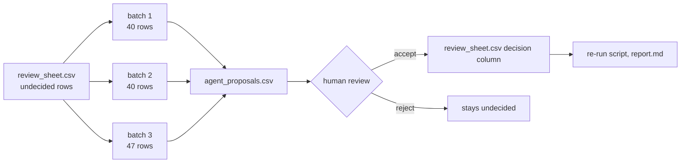

# Plan: curate the remaining review-sheet rows in batches

Status: draft. No agents have been started, and nothing is written to the database.

## Where we are

- `curation/review_sheet.csv` has the undecided rows from the top 500 unmatched keywords (about 127).
- 632 decisions are saved in `curation/keyword_decisions.csv`.
- Matches went from 553 (2.9%) to 725 (3.8%) of non-noise keywords.
- Records with a SoilVoc subject went from 5,082 (15.1%) to 5,718 (17.0%).

## Open question: should small agents (Haiku) do the rest?

| | Pro | Con |
|---|---|---|
| Speed | Rows can be split into batches of about 40 and done in parallel | Only about 127 rows are left, which is a few minutes of work by hand |
| Quality | Fine for obvious noise (country names, codes) | The remaining rows are the ambiguous ones (`water`, `bodenform`, `quality`). A small model will guess, and a wrong `synonym` creates a wrong match |
| Policy | None | You said no LLM for this work. Decisions made by a model are LLM output, even if the matcher itself is rule-based |
| Cost | Cheap per call | Setup and review take about as long as the work |

## Recommendation

1. Do not use agents for the semantic rows. Review the ~127 remaining rows yourself, or with me row by row.
2. If you do use agents, limit them to `noise` versus `skip` only. They may not write `synonym`, `broader` or `new_term`.
3. Every agent decision is written to a separate file, `curation/agent_proposals.csv`, and only merged into the sheet after a human has looked at it.

## If agents are used: batch design

Each agent gets: its 40 rows, the allowed decision values, the list of SoilVoc concept URIs, and the rule "when unsure, say `skip`".

## Done when

- The sheet has no undecided rows, or only rows marked `skip`.
- `report.md` is regenerated and the before and after numbers are noted here.
