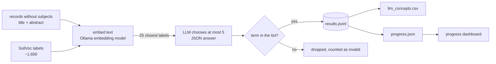

# Propose SoilVoc subjects for records without subjects (LLM)

For the records that have **no subjects** in the database (about 23,600 of 33,566 in stage, 23,300 of them with a title and abstract), this proposes SoilVoc concepts from the title and abstract.

It is **read-only**. The database is only read (a `SELECT` in a read-only session). Results go to files in `reports/llm_extraction/`. Nothing is written to the database.

The approach follows `soilwise-he/metadata-augmentation` (keyword-extractor, KeyLLM). It is **not validated**: there is no labelled test set yet, so treat the output as suggestions and review a sample before using it anywhere.

## How it works



Procedures (`sosa:Procedure`, e.g. `ExchAcid_ph0-kcl1m`) are left out because they never occur in running text.

## Set-up on a new computer

1. Python 3.10 or newer, then `pip install -r requirements-llm.txt`.
2. Install [Ollama](https://ollama.com) and pull an embedding model and an LLM:
   ```
   ollama pull nomic-embed-text
   ollama pull qwen2.5:14b        # or another model, see below
   ```
3. For `--from-db`, put the database settings in `.env` (same file as the comparison script, never committed).
4. Check: `python scripts/llm_extract_subjects.py --records sample.json --limit 5`

## Quickest way: one script

```
bash scripts/run_extraction.sh                      # all records without subjects
LIMIT=200 bash scripts/run_extraction.sh            # first test with 200 random records
MODEL=qwen2.5:14b WORKERS=2 bash scripts/run_extraction.sh
```

It checks Python and Ollama, installs the Python packages, starts Ollama if needed, downloads the models (skipped when already present), counts the records to process and asks for confirmation, opens the progress page in the browser (progress bar, records per minute and estimated time remaining), and runs the extraction. The settings are listed at the top of the script. Ctrl+C stops safely, and the same command continues later.

The steps below do the same thing by hand.

## Run

Terminal 1, the dashboard:

```
python scripts/progress_ui.py          # then open http://localhost:8765
```

Terminal 2, the extraction:

```
# small test on a file (JSON list, {"records": [...]}, or CSV with identifier,title,abstract)
python scripts/llm_extract_subjects.py --records sample.json --limit 50

# records without subjects from the database, 200 random ones first
python scripts/llm_extract_subjects.py --from-db --limit 200 --model qwen2.5:14b

# everything, two records at a time
python scripts/llm_extract_subjects.py --from-db --model qwen2.5:14b --workers 2
```

**Stop and continue.** Ctrl+C stops safely. Run the same command again and it continues where it stopped, because finished records are kept in `results.jsonl`. Records that failed are retried. Use `--fresh` to start over.

**Faster on a bigger PC.**
- A GPU with more memory lets you use a larger model. Rough guide: 8 GB → 7-8B models, 16 GB → 14B, 24 GB or more → 27-32B.
- `--workers N` runs N records at once. Start Ollama with `OLLAMA_NUM_PARALLEL=N` so it can answer them in parallel.
- Measured on a 4 GB GPU laptop with `llama3.2:3b`: about 2 to 6 seconds per record, so roughly 14 to 30 hours for all 23,300 records. A larger model is slower per record, so test 100 records first and look at the dashboard's records-per-minute and remaining-time numbers.

## Options

| Option | Default | Meaning |
|---|---|---|
| `--records FILE` / `--from-db` | required | where the records come from |
| `--limit N` | all | stop after N records (random order for `--from-db`) |
| `--model` | `llama3.2:3b` | Ollama model, or an OpenRouter id with `--provider openrouter` |
| `--embed-model` | `nomic-embed-text` | Ollama embedding model |
| `--top-k` | 25 | candidate labels shown to the LLM per record |
| `--max-terms` | 5 | most terms kept per record |
| `--workers` | 1 | records processed in parallel |
| `--provider` | `ollama` | `openrouter` sends the text to a hosted API (needs `OPENROUTER_API_KEY` in `.env`) |
| `--out` | `reports/llm_extraction` | where the results and progress files go |
| `--fresh` | off | ignore earlier results in `--out` |

**Privacy.** With `--provider ollama` nothing leaves your computer. With `--provider openrouter` the titles and abstracts go to the provider, and free models may train on them. OpenRouter's free tier allows only 50 requests a day.

## Output files (`--out`)

| File | Content |
|---|---|
| `results.jsonl` | one line per finished record: id, title, chosen concepts (label and URI), invalid count, model, time |
| `llm_concepts.csv` | the same as one row per record and concept: `record_identifier, matched_label, concept_uri, concept_label, model` |
| `progress.json` | live status for the dashboard |
| `label_embeddings_*.npy` | cache of the SoilVoc label embeddings |

`results.jsonl` can get large for the full run, so check before committing it.

## The dashboard

`scripts/progress_ui.py` shows, refreshed every 3 seconds: status (running, stopped, finished, error), percent done, records per minute, time remaining, records with no term, invalid terms, errors, a histogram of terms per record, the most chosen concepts and the latest records. Use `--host 0.0.0.0` to watch from another computer on the same network. It reads files only.

If the run stops with an error, the dashboard shows the reason (for example a used-up OpenRouter daily limit or Ollama not running). Fix it and run the same command again.

## What we know about quality

- On 50 random records, `llama3.2:3b` with the first version of the prompt chose 8 terms per record on average and also tagged off-topic records (an administrative document got `arsenic`). The prompt now asks for at most 5 clearly relevant terms; that version has only been tried on 11 records.
- Larger models are expected to be stricter, but this has not been measured.
- Before a full run: run 100 records, read 30 of them, and check how many of the chosen concepts are right, and whether off-topic records get no concepts. Only then run everything.
- Write the accepted results to the database later, with the method stored as `llm` so they can be told apart from the rule-based matches (`SUBJECT_FACETS_PLAN.md`).
