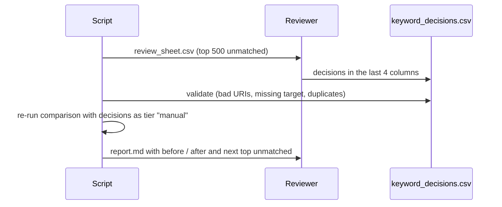
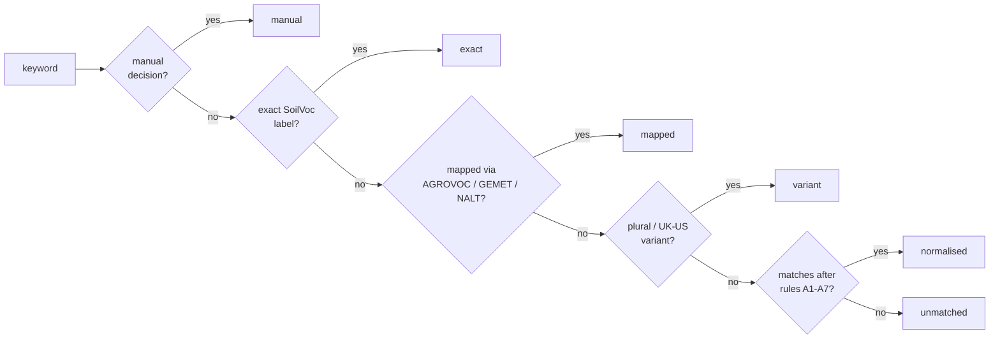

# Plan: raise the keyword–SoilVoc match rate (CSV only)

Status: both steps are implemented in `scripts/compare_subjects_to_soilvoc.py`. Decisions for the top ~700 keywords are in `curation/keyword_decisions.csv`. Current numbers are in `reports/subjects_vs_soilvoc/report.md`: matched keywords 553 (2.9%) → 731 (3.9%), records with a SoilVoc subject 5,082 (15.1%) → 5,762 (17.2%).

Scope: two steps from the earlier suggestions.

1. **Normalising** (better text cleaning before matching)
2. **Curation** (a human reviews the biggest unmatched keywords)

**Nothing is written to the database.** Input is read-only (SELECTs); every output is a CSV or Markdown file in `reports/`. Writing to the DB is a later, separate decision. No LLM is used.

Baseline (stage DB, `validate` schema, from `reports/subjects_vs_soilvoc/report.md`):

| | Now |
|---|---|
| Unique keywords (non-noise) | 19,267 |
| Matched (exact + mapped + variant) | 553 (2.9%) |
| Records with a SoilVoc subject | 5,082 of 33,566 (15.1%) |

---

## Overview

```mermaid
flowchart TD
    DB[(Stage DB<br/>read-only SELECT)] --> S[compare_subjects_to_soilvoc.py]
    V[SoilVoc_concepts.csv<br/>+ ontovocabs/*.csv] --> S

    S --> N[Step A: normalise<br/>new rules]
    N --> T[tiers: exact → mapped → variant<br/>→ normalised → manual]
    T --> R1[(matched.csv)]
    T --> R2[(unmatched.csv)]
    T --> R3[(noise.csv)]

    R2 --> C[Step B: curation sheet<br/>top N unmatched]
    C -->|reviewer fills decision column| M[(keyword_decisions.csv)]
    M -->|loaded as tier "manual"| T

    R1 --> REP[report.md<br/>before / after]
    R2 --> REP
    M --> I[(soilvoc_new_terms.csv + soilvoc_synonym_candidates.csv<br/>to submit)]
```

The loop is: run → review the top unmatched → save decisions → run again. Each run reports before/after coverage.

---

## Step A: better normalising

All rules are mechanical and are applied to the keyword, never to SoilVoc itself. A new match found this way gets tier `normalised`, so it stays visible and separate from `exact`.

| # | Rule | Example (keyword → what is matched) |
|---|---|---|
| A1 | `-`, `_`, `.` between words become spaces | `soil-scans` → `soil scans` |
| A2 | Split camel-case | `SoilBody` → `soil body` |
| A3 | Strip wrappers: `name=…`, `keyword:`, leading `#` | `name=water science` → `water science` |
| A4 | Strip bracketed codes | `[sdv.sa.sds] life sciences` → `life sciences` |
| A5 | Split on `/` and match each part, keeping the path | `…/agricultural sciences/soil study` → `agricultural sciences`, `soil study` |
| A6 | Remove accents for comparison (not for display) | `sól` ↔ `sol` |
| A7 | Drop a leading `ejp`/project-style prefix when the rest matches | `ejp soil` → `soil` |

Rules A1–A4 and A6 are safe. **A5 and A7 can create wrong matches** (for example a path part like `life sciences` matching something unrelated), so they go in a separate sub-tier `normalised_path`/`normalised_prefix` and are reviewed first.

Guards:
- Never match single generic words (`surface`, `layer`, `between`, `two`, `below`). Keep a small `stoplist.csv` that the reviewer can edit.
- Never apply a rule to labels under 3 characters.
- Keep the original keyword in the output next to the cleaned one.

Output of step A: the existing report files plus two new columns in `matched.csv`: `rule` (A1…A7) and `cleaned_keyword`.

---

## Step B: curation

### B1. Build the review sheet

`curation/review_sheet.csv`, one row per unmatched keyword, sorted by record count, limited to the top N (start with 500, which covers every keyword that appears in at least about 20 records).

| Column | Filled by | Content |
|---|---|---|
| `keyword` | script | normalised keyword |
| `records` | script | number of records using it |
| `example_raw_labels` | script | up to 3 original DB labels |
| `suggested_concept_uri` | script | closest SoilVoc concept by shared words (a hint only) |
| `suggested_concept_label` | script | its label |
| `decision` | **reviewer** | one of the values below |
| `target_concept_uri` | **reviewer** | for `synonym` and `map` |
| `new_term_label` | **reviewer** | for `new_term` |
| `notes` | **reviewer** | free text |

Allowed `decision` values:

| Decision | Meaning | Effect |
|---|---|---|
| `synonym` | Same thing as an existing SoilVoc concept | Matches `target_concept_uri` in the next run |
| `broader` | Fits under an existing concept but is more specific | Matches the target concept, flagged as broader |
| `new_term` | Real soil topic missing from SoilVoc | Goes to the SoilVoc issue candidates file |
| `noise` | Not a subject (portal tag, sentence fragment) | Moves to `noise.csv` |
| `skip` | Not sure | Stays unmatched |

### B2. Review workflow



Rules for the reviewer:
- Work from the top down; stop when the gain per hour drops.
- Prefer `synonym` over `new_term` when a concept already exists.
- Use `noise` freely for portal tags. The `noise` decisions are stored too, so they are not asked about again.
- Non-English keywords (`boden`, `suolo`) are valid `synonym` decisions here. They can be added to SoilVoc as altLabels with a language tag later.

### B3. Validation of decisions

The script refuses to run if a decision file has:
- a `target_concept_uri` that is not in `SoilVoc_concepts.csv`
- `synonym`/`broader` without a target, or `new_term` without a label
- the same keyword decided twice with different results

### B4. Outputs

| File | Content |
|---|---|
| `curation/review_sheet.csv` | the sheet to fill in (regenerated each run, skips keywords already decided) |
| `curation/keyword_decisions.csv` | accumulated decisions, kept in git |
| `curation/soilvoc_new_terms.csv` | proposed new terms, one row per term, grouped, in the column layout of `templates/template_addterms.csv` plus `group`, `records` and `other_keywords_in_db` |
| `curation/soilvoc_synonym_candidates.csv` | `synonym` and `broader` decisions as altLabel candidates for existing concepts |
| `curation/new_term_groups.csv` | label → group lookup used to group the new-terms file |
| `curation/stoplist.csv` | generic words that must never match |

---

## Matching order after both steps



Manual decisions come first so a reviewer can always override an automatic match, but only for keywords they chose to decide.

---

## Deliverables and order of work

1. Add rules A1–A7 and the stoplist to `scripts/compare_subjects_to_soilvoc.py` as the `normalised` tier. Re-run and record the new coverage.
2. Add `--curation-dir` support: generate `review_sheet.csv`, read `keyword_decisions.csv` and add the `manual` tier.
3. Add before/after columns to `report.md`.
4. Review the first 500 keywords.
5. Re-run, check coverage, decide whether to review the next batch.

## How we will know it worked

| Metric | Where it shows |
|---|---|
| Unique keywords matched, per tier | `report.md` tier table |
| Records with a SoilVoc subject | `report.md` summary |
| Matches added per rule (A1–A7) | `matched.csv` `rule` column |
| Matches that a reviewer rejected | spot-check 50 random `normalised` rows per run |

Targets are not set, because I have not measured what each rule adds. After step 1 we will know the real gain from normalising, and that decides how much reviewing is worth doing.

## Not in this plan

- Any write to the database (stage or dev).
- Changes to `SoilVoc.ttl` or `SoilVoc_concepts.csv`. Candidate terms are only listed for submission through the normal issue process.
- Substring matching inside long phrases and extra language labels (steps 3 and 4 of the earlier suggestions).
- Any LLM or embedding-based matching.
