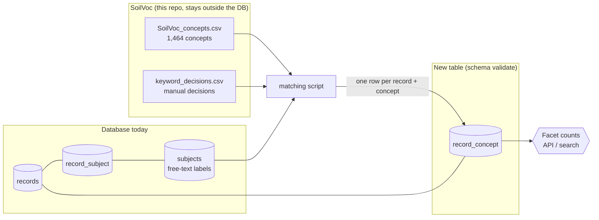
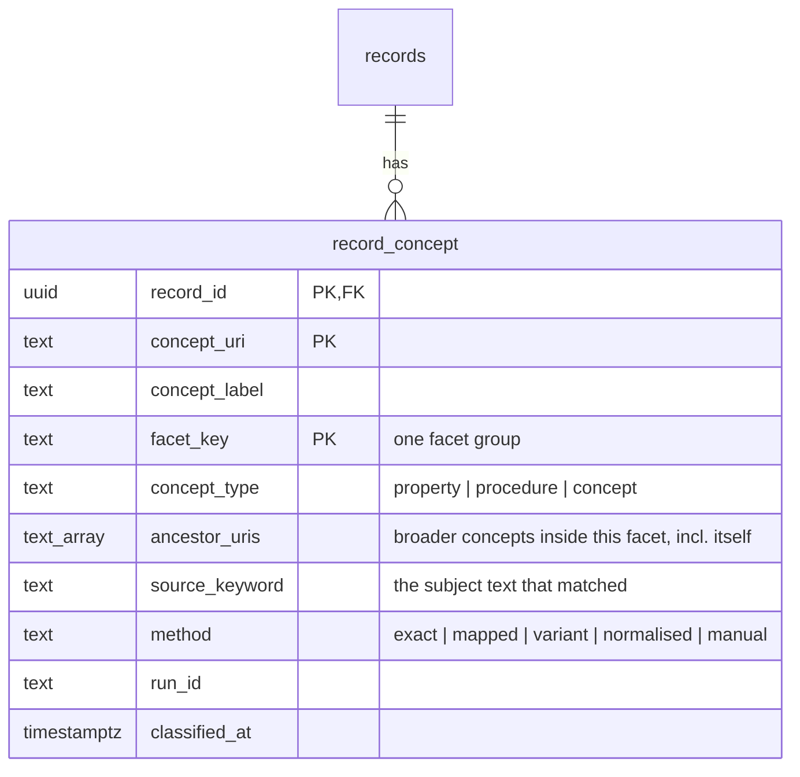
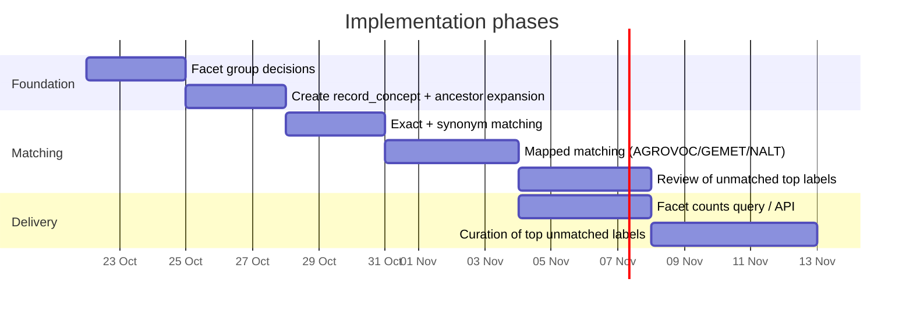

# Plan: Subject classification facets from SoilVoc

Goal: replace the free-text keywords in the database with SoilVoc concepts, so that records can be filtered by faceted subjects (property, method, function, threat, process, management, ecosystem service…).

Based on a **read-only** look at the database (the stage database `msp-kh-stage`, schema `validate`). No data was changed. The counts in section 1 were taken from the dev database and are only indicative. Current stage numbers are in `reports/subjects_vs_soilvoc/report.md`.

No LLM, embedding or fuzzy-similarity matching is used. Every match comes from a fixed rule or a human decision.

---

## 1. What is in the database today

| Item | Value |
|---|---|
| Records (`validate.records`) | 33,566 (33,516 `pending`, 50 `approved`) |
| Records with at least one subject | 9,927 (30%) |
| Distinct subjects (`validate.subjects`) | 20,169 |
| Record–subject links (`validate.record_subject`) | 106,901 (avg 10.8 per record, max 122) |
| Subjects with a `uri` | **0** |
| Subjects with a `vocabulary_name` | **0** |
| Subject labels that exactly equal a SoilVoc prefLabel/altLabel | **463** (2%) |
| Links covered by those 463 labels | **12,063** (11% of all links) |

So `subjects` is a flat list of free text. The columns `uri`, `vocabulary_name` and `vocabulary_url` exist but are empty, and there is no hierarchy and no facet grouping.

### The labels are mixed

The most-used labels show that three different things are stored in one table:

| Kind | Examples (links) | Use for soil facets? |
|---|---|---|
| Soil topics | `soil` (2,108), `geology` (566), `land cover` (275), `soil organic carbon` (204), `soil erosion` (175) | **Yes**, map to SoilVoc |
| Generic classifications | `15. life on land` (2,438), `2. zero hunger` (1,852), `01 natural sciences` (1,357), `0401 agriculture, forestry, and fisheries` (1,043) | **No**, these are SDG and OECD field codes. Keep as a separate "Other classification" group |
| Noise / admin | `tech` (813), `opendata` (770), `national` (582), `inspireidentifiziert` (540), dates, codes | **No**, hide or drop |

### Related things that already exist

- `validate.landcover_types` + `validate.record_landcover`: a code table plus a per-record link table, filled by a classifier. **This is the pattern to copy** for subjects.
- `../Subject_facit_comparison/soilwise_facets.json`: 9 soil facet groups with 139 hand-picked terms (chemical, biological and physical properties, classification, functions, threats, processes, management, ecosystem services). 97 of them already exist in the DB as labels. This is a good seed for facet groups.

---

## 2. Target design: one new table



Design choices:

1. **Do not rewrite `subjects`.** It stays as the raw harvested keywords. The new table sits beside it, as `record_landcover` does.
2. **One table, no vocabulary tables.** SoilVoc itself stays in this repo (the CSV, and the API under `api/`). The matching script reads it and writes the result already expanded, so the database needs no copy of the vocabulary, no label map and no closure table.
3. **Store the concept URI**, not only the label. Labels can change, URIs do not.
4. **Store the ancestors on each row** in an array (`ancestor_uris`). A record tagged "root abundance" is then counted under "plant cover" and "land cover" with an array lookup and no recursive query.
5. **Keep the match method** on each row, so a reviewer can find weak matches and the script can be re-run.

### The table (draft)



One row per record, concept **and facet group**. A concept that sits in two facet groups gets two rows, and each row's `ancestor_uris` contains only the ancestors inside that facet. That keeps each facet tree separate, so the application does not have to filter out ancestors from other groups.

Indexes: primary key `(record_id, concept_uri, facet_key)`, a btree on `facet_key`, and a GIN index on `ancestor_uris`.

Compared with the earlier five-table design (`vocab_concept`, `vocab_concept_ancestor`, `vocab_label_map`, `record_concept`, `facet_group`):

| | One table | Five tables |
|---|---|---|
| New objects in the DB | 1 | 5 |
| Vocabulary changes in SoilVoc | Re-run the script (it replaces rows with the same `run_id`) | Reload the `vocab_*` tables, then re-run the matching |
| Ancestor labels for a facet tree | From the SoilVoc API or CSV in the application | `JOIN` inside the DB |
| Row size | Larger (arrays repeated per row) | Smaller |
| Facet group names | In a config file (`soilwise_facets.json`) | `facet_group` table |

The one-table version suits the current scale (about 10,000 records with subjects, a few tens of thousands of links). If the vocabulary has to be queried from inside the DB, add `vocab_concept` back later. The `record_concept` columns would not change.

---

## 3. Facet groups

Proposed groups. The first nine come from the existing `soilwise_facets.json`. The last three are suggestions from the SoilVoc top concepts.

| Facet key | Label | SoilVoc branch (top concept) |
|---|---|---|
| `soil_chemical_properties` | Chemical properties | soil properties → chemical |
| `soil_physical_properties` | Physical properties | soil properties → physical |
| `soil_biological_properties` | Biological properties | soil properties → biological |
| `soil_classification` | Soil classification | soil classification |
| `soil_functions` | Soil functions | soil functions |
| `soil_threats` | Soil threats | soil processes / soil phenomena (degradation, erosion…) |
| `soil_processes` | Soil processes | soil processes |
| `soil_management` | Soil management | soil management |
| `ecosystem_services` | Ecosystem services | ecosystem services |
| `environment_context` | Land cover, geology, physiography | land cover, geology, physiography, planetary phenomena |
| `method` | Observation method | concepts typed `sosa:Procedure` |
| `other_classification` | SDG / OECD fields | not from SoilVoc, kept from the DB as-is |

Caveats from SoilVoc:
- 131 concepts have two or more parents. A facet tree must show them once (or accept that they appear under both parents), and counts must use `COUNT(DISTINCT record_id)`.
- `soil description` is a branch of value classes (texture class, porosity class). Leave it out of the subject facets.
- `soil`, `soil health` and `soil quality` have no children. They are tags, not drill-down facets.

---

## 4. Phases



Dates are placeholders to show the order, not commitments.

### Phase 0: Decide (before coding)
- Confirm the facet groups in section 3.
- Decide the scope: only `validate` schema, or also `metadata` (it has the same `subjects` / `record_subject` tables).
- Decide what happens to SDG/OECD codes and noise labels (recommended: keep them in `other_classification` and `hidden`).

### Phase 1: Prepare the table and the vocabulary lookup
- Script `scripts/load_record_concepts.py` reads `SoilVoc_concepts.csv`, builds each concept's ancestor list from `broader` in memory, assigns `facet_key` (one row per facet) by walking up to the matching top concept, and writes `record_concept`.
- Note: the header and cells of `SoilVoc_concepts.csv` are space-padded, so strip them when reading (`scripts/compare_subjects_to_soilvoc.py` already does).
- Add the single table with an Alembic migration (the DB already has `alembic_version`), in whichever repo owns that migration history.
- Make it idempotent: delete the rows of the previous `run_id` and insert the new ones inside one transaction.

### Phase 2: Match existing subjects (cheap, high value)
Applied in this order, stopping at the first hit:

```mermaid
flowchart TD
    L[subject label] --> N[normalise<br/>lowercase, trim, strip punctuation]
    N --> SP{contains , or ; ?}
    SP -- yes --> SPL[split into separate keywords]
    SP -- no --> M1
    SPL --> M1{equals SoilVoc<br/>prefLabel / altLabel?}
    M1 -- yes --> OK1[method = exact]
    M1 -- no --> M2{equals an AGROVOC / GEMET / NALT<br/>label linked by exactMatch?}
    M2 -- yes --> OK2[method = mapped]
    M2 -- no --> M3{plural, UK/US spelling,<br/>"soil " prefix variant?}
    M3 -- yes --> OK3[method = variant]
    M3 -- no --> M4{cleaning rules A1-A7<br/>or manual decision?}
    M4 -- yes --> OK4[method = normalised / manual]
    M4 -- no --> U[unmatched<br/>→ review list]
```

- Reuse the normalisation and splitting rules from `../Subject_facit_comparison/compare_facets.py`.
- `scripts/uk2us.py` in this repo already handles UK→US spelling.
- Expected result from exact matching alone: 463 labels, 11% of links. The mapped step should raise this, but I have not measured by how much.

### Phase 3: Review the gaps
- Export unmatched labels sorted by link count. The top few hundred will cover most of the remaining value.
- Decide for each: add as an altLabel in SoilVoc (through the repo's GitHub issue templates), map manually, or mark as noise.
- Do not write guesses into `record_concept` without a `method` and `source_keyword`.

### Phase 4: Serve the facets
Facet counts for one group, with ancestor roll-up (the application adds the labels from SoilVoc):

```sql
SELECT a.uri AS concept_uri, COUNT(DISTINCT rc.record_id) AS records
FROM validate.record_concept rc
CROSS JOIN LATERAL unnest(rc.ancestor_uris) AS a(uri)
WHERE rc.facet_key = 'soil_threats'
GROUP BY a.uri
ORDER BY records DESC;
```

Filtering: a record matches a selected concept if any of its `record_concept` rows has that concept in `ancestor_uris`:

```sql
SELECT DISTINCT record_id
FROM validate.record_concept
WHERE facet_key = 'soil_threats'
  AND ancestor_uris @> ARRAY['https://w3id.org/eusoilvoc#SoilErosion'];
```

Because each row lists only the ancestors of its own facet, the counts of one group never include concepts from another group. Count with `COUNT(DISTINCT record_id)`, since a record can have several concepts under the same ancestor.

### Phase 5 (optional): Better coverage
- Records with no subjects at all (about 70%) get no SoilVoc tag from this work. Tagging them from title and abstract would need a text classifier, which is outside this plan.
- Instead, grow coverage by curation: review the top unmatched keywords (see `MATCH_IMPROVEMENT_PLAN.md`) and submit missing terms to SoilVoc (`curation/soilvoc_new_terms.csv`).
- Never let automatic results overwrite `manual` ones. Store `run_id` and `classified_at`, as `landcover-landuse-classifier` does for land cover.

---

## 5. Risks and open questions

| Risk / question | Effect | Mitigation |
|---|---|---|
| Only 2% of labels match exactly | Low facet coverage at first | Add mapped matching, then curate the top unmatched labels |
| Labels are multi-language (`boden`, `služba zpřístupnění map (wms)`) | No match for non-English | Use AGROVOC/GEMET mappings (they carry other languages), or translate |
| Keyword strings like `pcb, flavonoids, rhizoremediation, chemotaxis` are stored as one label | Missed matches | Split on `,` and `;` before matching |
| Multiple parents in SoilVoc | Double-counting | `COUNT(DISTINCT record_id)` |
| SoilVoc lacks some DB terms (e.g. `sulphur`, `urea`, `sewage sludge`, `sedimentation` appear only in the hand-made facet file) | Gaps in facets | Submit them as new terms through the SoilVoc issue templates |
| 33,516 of 33,566 records are `pending` | Facets may include unapproved records | Filter on `approval_status` in the facet query |
| Same tables exist in `metadata` and `validate` | Risk of changing the wrong one | Confirm the target schema in Phase 0 |

---

## 6. First concrete steps

1. Confirm the facet groups (section 3) and the target schema.
2. Write `scripts/load_record_concepts.py`, test it against a copy or with `--dry-run` that only writes a CSV, and only then run it against `validate`.
3. Run the exact-match step and report coverage per facet group.
4. Review the top 200 unmatched labels together.
