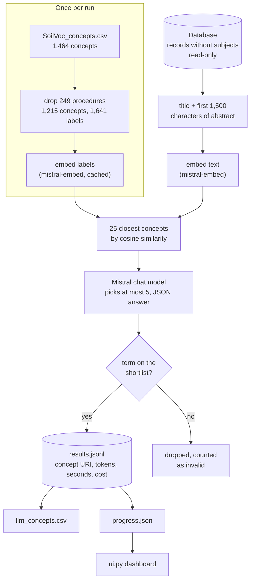
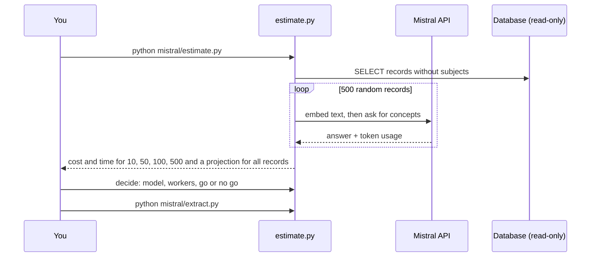
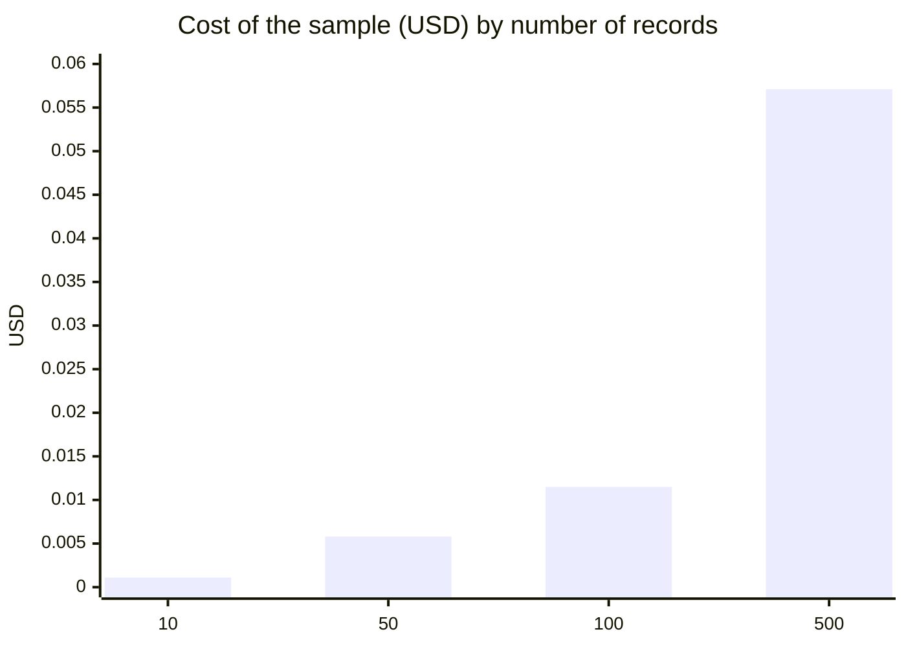
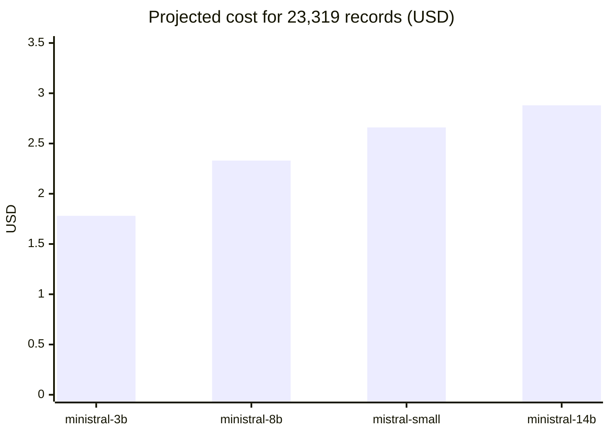

# Mistral extraction: propose SoilVoc subjects for records without subjects

Uses the **Mistral API** to choose SoilVoc concepts from a record's title and abstract. It is the hosted-API sibling of the local-Ollama version in `../scripts/llm_extract_subjects.py` (see `../LLM_EXTRACTION.md`). Both can stay side by side.

- The database is only **read** (a `SELECT` in a read-only session). Nothing is written to it.
- Titles and abstracts of the processed records are **sent to Mistral**.
- Results are suggestions. Quality has not been checked against labelled data yet (see "Quality").

## How it works



Why a shortlist: the model only sees 25 candidates, so it cannot invent terms and each request stays small (about 470 input tokens). The limit is that a concept missing from the shortlist can never be chosen.



## Estimate (measured 22 October 2026)

`mistral-small-latest`, 4 workers, a random sample of 500 of the 23,319 records without subjects that have a title and abstract.

| Records | Time | Cost (USD) | Input tokens | Output tokens | Avg terms | No term |
|---|---|---|---|---|---|---|
| 10 | 4 s | 0.0011 | 4,261 | 306 | 4.7 | 0 |
| 50 | 17 s | 0.0058 | 22,401 | 1,608 | 4.82 | 0 |
| 100 | 33 s | 0.0115 | 44,291 | 3,176 | 4.77 | 2 |
| 500 | 7 min 19 s | 0.0571 | 220,392 | 15,825 | 4.78 | 11 |
| **All 23,319** | **about 5 h 42 min** | **about $2.66** (range $2.59 to $2.72) | | | | |



Cost for all records with the same tokens on other models (time and quality not tested):



- **Cost is predictable.** Every record uses about the same number of tokens (about 470 in, 32 out), so the range is narrow.
- **Time is not.** The first 100 records took 0.33 s each, which would be about 2 h 10 min for everything. The 500-record run slowed to 0.88 s each because Mistral replied "rate limit" (HTTP 429) 40 times, and the script waits and retries. The 5 h 42 min figure uses the slower rate. Your account tier decides how many requests per second you get; more workers will not help once you hit the limit.
- **Prices** are in `prices.json` (USD per million tokens, from the model cards on docs.mistral.ai, checked 22 October 2026). The `mistral-embed` price (0.10) was not checked against the pricing page. Confirm both in the Mistral console before a large run. If a price is wrong, edit `prices.json` and re-run `estimate.py`.

## Set-up

1. Python 3.10 or newer and `pip install -r ../requirements-llm.txt` (needs `numpy` and, for the database, `psycopg2-binary`).
2. `.env` in the repo root (git-ignored, never committed) with the database settings (`DB_HOST1`, `DB_PORT1`, `DB_NAME1`, `DB_USER1`, `DB_PASSWORD1`, `DB_SCHEMA1`) and:
   ```
   MISTRAL_API_KEY=...
   ```
3. No Ollama is needed. Embeddings also come from Mistral.

## Run

Terminal 1, the dashboard (reads files only):

```
python mistral/ui.py --out mistral/runs/estimate-mistral-small-latest     # http://localhost:8766
python mistral/ui.py                                                       # watches mistral/runs/extract
```

Terminal 2:

```
# 1. cost and time estimate on a random sample (a few cents)
python mistral/estimate.py                                   # sizes 10,50,100,500; 4 workers; mistral-small-latest
python mistral/estimate.py --model ministral-8b-latest --workers 8
python mistral/estimate.py --sizes 10,50                     # smaller test

# 2. the real run (asks for confirmation; add --yes to skip)
python mistral/extract.py --limit 100                        # first 100 random records
python mistral/extract.py --model mistral-small-latest --workers 4   # all records without subjects
```

Ctrl+C stops safely. Running the same command again continues, because finished records are kept in `results.jsonl`. Failed records are retried.

| Option | Default | Meaning |
|---|---|---|
| `--model` | `mistral-small-latest` | must be in `prices.json` |
| `--embed-model` | `mistral-embed` | |
| `--workers` | 4 | requests in parallel; use the number you plan for the full run when estimating |
| `--limit` | all | `extract.py` only |
| `--sizes` | `10,50,100,500` | `estimate.py` only |
| `--top-k` | 25 | candidate concepts shown to the model |
| `--max-terms` | 5 | most terms kept per record |
| `--seed` | 0.42 | fixes the random order, so estimate and run use the same records first |
| `--out` | `mistral/runs/...` | where files go |

## The dashboard

`ui.py` refreshes every 2.5 seconds and shows:

- status, a **progress bar**, percent done and **estimated time remaining**
- **cost so far**, cost per record, and the **projected cost and time for all records**
- input and output tokens, records per minute, rate-limit replies, errors
- after `estimate.py`: the table of 10, 50, 100 and 500 records with the all-records projection
- most chosen concepts and the latest records with the terms chosen, seconds and cost

## Files in `mistral/`

| File | Purpose |
|---|---|
| `estimate.py` | calls the API for a sample; writes `estimate.md` and `estimate.json` |
| `extract.py` | the real run; writes `results.jsonl` and `llm_concepts.csv` |
| `ui.py` | the dashboard |
| `common.py` | shared code: API calls with retry, embeddings, shortlist, prompt, cost and progress tracking |
| `prices.json` | prices per million tokens |
| `runs/<name>/` | one folder per run: `results.jsonl` (one line per record), `llm_concepts.csv` (one row per record and concept), `progress.json`, `estimate.md/json`, cached label embeddings |

`llm_concepts.csv` columns: `record_identifier, matched_label, concept_uri, concept_label, model`.

## Quality

- On the 500-record sample the model chose 4.78 terms per record on average, out of a maximum of 5, and only 11 records got none. That is close to "always fill the list", and the sample includes off-topic records (administrative documents). Expect loosely related picks, for example `soil fumigation` for a paper on marigold cultivation.
- Good cases exist too: a paper on organic matter and conservation tillage got `soil organic matter`, `conservation tillage`, `soil microbial biomass`, `soil respiration` and `soil carbon sequestration`.
- Before the full run, read about 30 results from `runs/.../results.jsonl` and judge them.
- Ideas to test: require the term's words to appear in the text, ask for a short quote as evidence, or lower `--max-terms`.
- The accepted results can be loaded into the database later with the method stored as `llm`, so they are separate from the rule-based matches (`../SUBJECT_FACETS_PLAN.md`).

## Cost control

- Run `estimate.py` first, and `extract.py --limit 100` before the full run.
- A hard stop happens on HTTP 401/402/403 (bad key or no credit). 8 errors in a row also stop the run.
- Set a spending limit in the Mistral console as well; this tool only measures cost, it does not enforce a budget.
