# SoilVoc hierarchy

Generated from `reports/soilvoc_keywords_by_level.csv` by `scripts/soilvoc_mermaid.py`. 1215 concepts under 17 top concepts, max depth 8. Concepts with several parents are drawn once, under their shortest path (see `all_parents` in the CSV). 249 detached GLOSIS procedure codes are not shown.

Orange nodes are collapsed branches; their full diagram is linked in the list under each chart.

## Overview (top concepts)

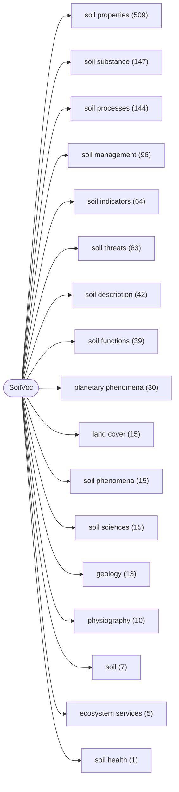

## Contents

- [soil properties](#soil-properties) (509)
  - [soil chemicophysical properties](#soil-properties--soil-chemicophysical-properties) (450)
    - [soil chemical properties](#soil-properties--soil-chemicophysical-properties--soil-chemical-properties) (31)
    - [soil physical properties](#soil-properties--soil-chemicophysical-properties--soil-physical-properties) (360)
      - [fragments](#soil-properties--soil-chemicophysical-properties--soil-physical-properties--fragments) (9)
      - [mineral concentration](#soil-properties--soil-chemicophysical-properties--soil-physical-properties--mineral-concentration) (9)
      - [soil contents](#soil-properties--soil-chemicophysical-properties--soil-physical-properties--soil-contents) (19)
      - [soil physical capacity](#soil-properties--soil-chemicophysical-properties--soil-physical-properties--soil-physical-capacity) (10)
      - [soil pore physical properties](#soil-properties--soil-chemicophysical-properties--soil-physical-properties--soil-pore-physical-properties) (12)
      - [soil types](#soil-properties--soil-chemicophysical-properties--soil-physical-properties--soil-types) (173)
        - [genetic soil types](#soil-properties--soil-chemicophysical-properties--soil-physical-properties--soil-types--genetic-soil-types) (75)
      - [soil water physical properties](#soil-properties--soil-chemicophysical-properties--soil-physical-properties--soil-water-physical-properties) (20)
- [soil substance](#soil-substance) (147)
  - [soil components](#soil-substance--soil-components) (39)
  - [soil nutrients](#soil-substance--soil-nutrients) (42)
- [soil processes](#soil-processes) (144)
  - [soil chemical processes](#soil-processes--soil-chemical-processes) (26)
  - [soil physical processes](#soil-processes--soil-physical-processes) (104)
- [soil management](#soil-management) (96)
- [soil indicators](#soil-indicators) (64)
- [soil threats](#soil-threats) (63)
- [soil description](#soil-description) (42)
- [soil functions](#soil-functions) (39)
- [planetary phenomena](#planetary-phenomena) (30)
- [land cover](#land-cover) (15)
- [soil phenomena](#soil-phenomena) (15)
- [soil sciences](#soil-sciences) (15)
- [geology](#geology) (13)
- [physiography](#physiography) (10)
- [soil](#soil) (7)
- [ecosystem services](#ecosystem-services) (5)
- [soil health](#soil-health) (1)

## soil properties

Path: soil properties · 509 concepts

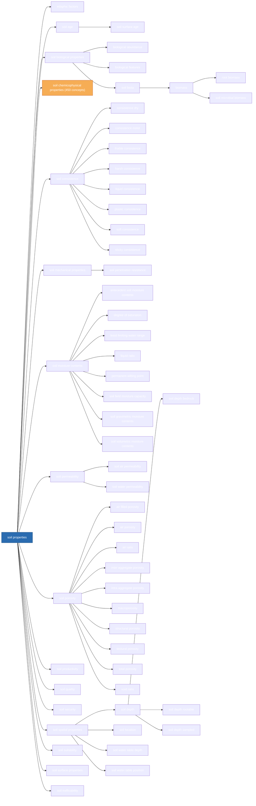

Collapsed branches:
- [soil chemicophysical properties](#soil-properties--soil-chemicophysical-properties) (450)

## soil properties / soil chemicophysical properties

Path: soil properties › soil chemicophysical properties · 450 concepts

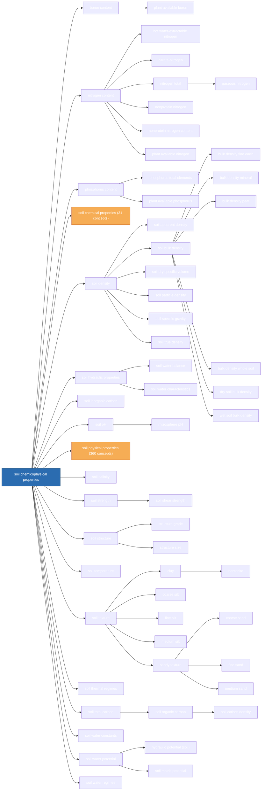

Collapsed branches:
- [soil chemical properties](#soil-properties--soil-chemicophysical-properties--soil-chemical-properties) (31)
- [soil physical properties](#soil-properties--soil-chemicophysical-properties--soil-physical-properties) (360)

## soil properties / soil chemicophysical properties / soil chemical properties

Path: soil properties › soil chemicophysical properties › soil chemical properties · 31 concepts

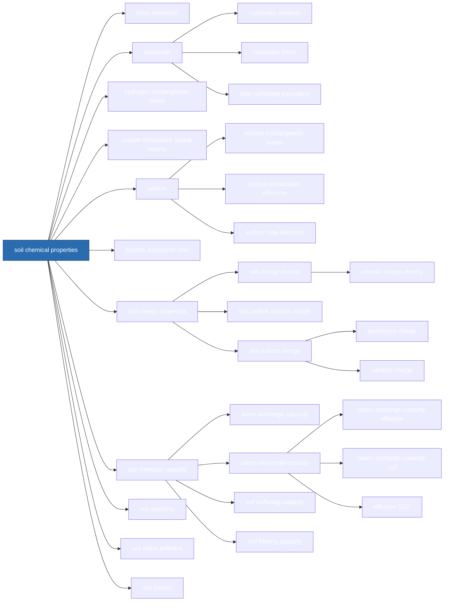

## soil properties / soil chemicophysical properties / soil physical properties

Path: soil properties › soil chemicophysical properties › soil physical properties · 360 concepts

```mermaid
flowchart LR
    n93["soil physical properties"]:::root
    n150["cementation"]
    n93 --> n150
    n151["cementation continuity"]
    n150 --> n151
    n152["cementation degree"]
    n150 --> n152
    n153["cementation fabric"]
    n150 --> n153
    n154["cementation nature"]
    n150 --> n154
    n155["fragments (9 concepts)"]:::more
    n93 --> n155
    n156["gypsum"]
    n93 --> n156
    n157["gypsum contents"]
    n156 --> n157
    n158["gypsum forms"]
    n156 --> n158
    n159["gypsum weight"]
    n156 --> n159
    n160["mineral concentration (9 concepts)"]:::more
    n93 --> n160
    n161["mineral particles"]
    n93 --> n161
    n162["mineral contents"]
    n161 --> n162
    n163["mineral fragments"]
    n161 --> n163
    n164["peat"]
    n93 --> n164
    n165["peat decomposition"]
    n164 --> n165
    n166["peat drainage"]
    n164 --> n166
    n167["peat volume"]
    n164 --> n167
    n168["soil adhesion"]
    n93 --> n168
    n169["soil aggregate physical properties"]
    n93 --> n169
    n170["soil aggregate degree"]
    n169 --> n170
    n171["soil aggregate shape"]
    n169 --> n171
    n172["soil aggregate size"]
    n169 --> n172
    n173["soil aggregate stability"]
    n169 --> n173
    n174["soil aggregation degree"]
    n169 --> n174
    n175["soil air physical properties"]
    n93 --> n175
    n176["gaseous composition of soil air"]
    n175 --> n176
    n177["soil air contents"]
    n175 --> n177
    n178["soil oxygen concentration"]
    n175 --> n178
    n179["soil oxygen contents"]
    n175 --> n179
    n180["soil clay mineralogy"]
    n93 --> n180
    n181["soil coating"]
    n93 --> n181
    n182["coating abundance"]
    n181 --> n182
    n183["coating contrast"]
    n181 --> n183
    n184["coating forms"]
    n181 --> n184
    n185["coating location"]
    n181 --> n185
    n186["coating nature"]
    n181 --> n186
    n187["soil cohesion"]
    n93 --> n187
    n188["soil cohesiveness"]
    n93 --> n188
    n189["soil colour"]
    n93 --> n189
    n190["soil colour dry"]
    n189 --> n190
    n191["soil colour moist"]
    n189 --> n191
    n192["soil compactability"]
    n93 --> n192
    n193["soil compressibility"]
    n93 --> n193
    n194["soil consistency"]
    n93 --> n194
    n195["dry consistency"]
    n194 --> n195
    n196["moist consistency"]
    n194 --> n196
    n197["soil contents (19 concepts)"]:::more
    n93 --> n197
    n198["soil cracking physical properties"]
    n93 --> n198
    n199["soil cracking intensity"]
    n198 --> n199
    n200["soil cracking number"]
    n198 --> n200
    n201["soil crust physical properties"]
    n93 --> n201
    n202["soil crust density"]
    n201 --> n202
    n203["soil crust strength"]
    n201 --> n203
    n204["soil crust thickness"]
    n201 --> n204
    n205["soil dispersibility"]
    n93 --> n205
    n206["soil elasticity"]
    n93 --> n206
    n207["soil electrical capacitance"]
    n93 --> n207
    n208["soil electrical conductivity"]
    n93 --> n208
    n209["soil erodibility"]
    n93 --> n209
    n210["soil horizon boundary"]
    n93 --> n210
    n211["boundary distinctness"]
    n210 --> n211
    n212["boundary topography"]
    n210 --> n212
    n213["soil hydraulic diffusivity"]
    n93 --> n213
    n214["soil intrinsic permeability"]
    n93 --> n214
    n215["soil mottle"]
    n93 --> n215
    n216["mottle abundance"]
    n215 --> n216
    n217["mottle boundary classification"]
    n215 --> n217
    n218["mottle colour"]
    n215 --> n218
    n219["mottle contrast"]
    n215 --> n219
    n220["mottle presence"]
    n215 --> n220
    n221["mottle size"]
    n215 --> n221
    n222["soil nutrient availability"]
    n93 --> n222
    n223["ammonium fixation"]
    n222 --> n223
    n224["soil packing arrangement"]
    n93 --> n224
    n225["soil particle physical properties"]
    n93 --> n225
    n226["particle size fraction sum"]
    n225 --> n226
    n227["soil particle arrangement"]
    n225 --> n227
    n228["soil particle shape"]
    n225 --> n228
    n229["soil particle size"]
    n225 --> n229
    n230["soil particle size distribution"]
    n225 --> n230
    n231["soil particle specific surface area"]
    n225 --> n231
    n232["soil permittivity"]
    n93 --> n232
    n233["soil physical capacity (10 concepts)"]:::more
    n93 --> n233
    n234["soil physical quality"]
    n93 --> n234
    n235["soil plasticity"]
    n93 --> n235
    n236["wet plasticity"]
    n235 --> n236
    n237["soil pore physical properties (12 concepts)"]:::more
    n93 --> n237
    n238["soil sensitivity"]
    n93 --> n238
    n239["soil solute physical properties"]
    n93 --> n239
    n240["soil pore water velocity"]
    n239 --> n240
    n241["soil solute dispersivity"]
    n239 --> n241
    n242["soil solute flux density"]
    n239 --> n242
    n243["soil stability"]
    n93 --> n243
    n244["soil slope stability"]
    n243 --> n244
    n245["soil structural resilience"]
    n93 --> n245
    n246["soil structural stability"]
    n93 --> n246
    n247["soil swell shrink properties"]
    n93 --> n247
    n248["soil swelling potential"]
    n247 --> n248
    n249["soil thermal properties"]
    n93 --> n249
    n250["soil thermal conductivity"]
    n249 --> n250
    n251["soil thermal diffusivity"]
    n249 --> n251
    n252["soil tilth"]
    n93 --> n252
    n253["soil transportability"]
    n93 --> n253
    n254["soil types (173 concepts)"]:::more
    n93 --> n254
    n255["soil vapour pressure"]
    n93 --> n255
    n256["saturated vapour pressure"]
    n255 --> n256
    n257["soil viscosity"]
    n93 --> n257
    n258["soil voids"]
    n93 --> n258
    n259["void classification"]
    n258 --> n259
    n260["void diameter"]
    n258 --> n260
    n261["soil volume"]
    n93 --> n261
    n262["soil water physical properties (20 concepts)"]:::more
    n93 --> n262
    n263["stickiness"]
    n93 --> n263
    classDef root fill:#2b6cb0,color:#fff,stroke:#1a4971
    classDef more fill:#f6ad55,stroke:#c05621
```

Collapsed branches:
- [fragments](#soil-properties--soil-chemicophysical-properties--soil-physical-properties--fragments) (9)
- [mineral concentration](#soil-properties--soil-chemicophysical-properties--soil-physical-properties--mineral-concentration) (9)
- [soil contents](#soil-properties--soil-chemicophysical-properties--soil-physical-properties--soil-contents) (19)
- [soil physical capacity](#soil-properties--soil-chemicophysical-properties--soil-physical-properties--soil-physical-capacity) (10)
- [soil pore physical properties](#soil-properties--soil-chemicophysical-properties--soil-physical-properties--soil-pore-physical-properties) (12)
- [soil types](#soil-properties--soil-chemicophysical-properties--soil-physical-properties--soil-types) (173)
- [soil water physical properties](#soil-properties--soil-chemicophysical-properties--soil-physical-properties--soil-water-physical-properties) (20)

## soil properties / soil chemicophysical properties / soil physical properties / fragments

Path: soil properties › soil chemicophysical properties › soil physical properties › fragments · 9 concepts

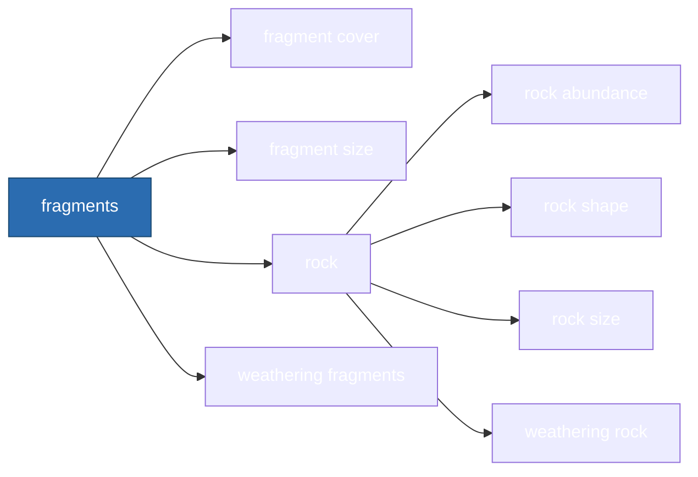

## soil properties / soil chemicophysical properties / soil physical properties / mineral concentration

Path: soil properties › soil chemicophysical properties › soil physical properties › mineral concentration · 9 concepts

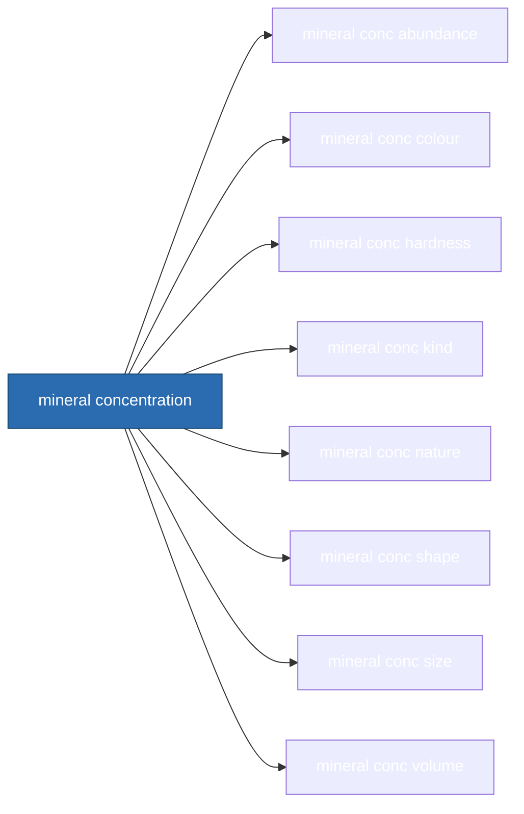

## soil properties / soil chemicophysical properties / soil physical properties / soil contents

Path: soil properties › soil chemicophysical properties › soil physical properties › soil contents · 19 concepts

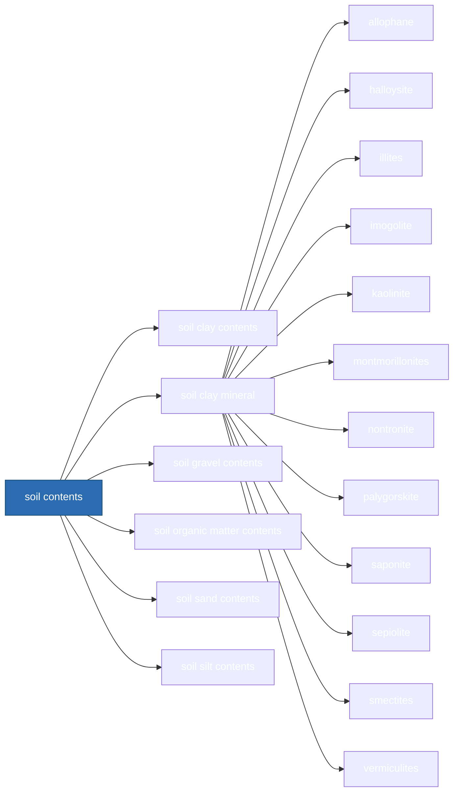

## soil properties / soil chemicophysical properties / soil physical properties / soil physical capacity

Path: soil properties › soil chemicophysical properties › soil physical properties › soil physical capacity · 10 concepts

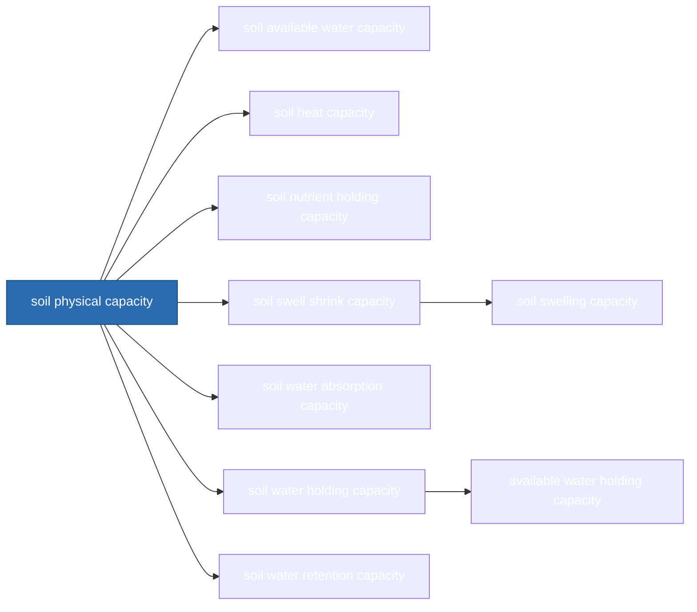

## soil properties / soil chemicophysical properties / soil physical properties / soil pore physical properties

Path: soil properties › soil chemicophysical properties › soil physical properties › soil pore physical properties · 12 concepts

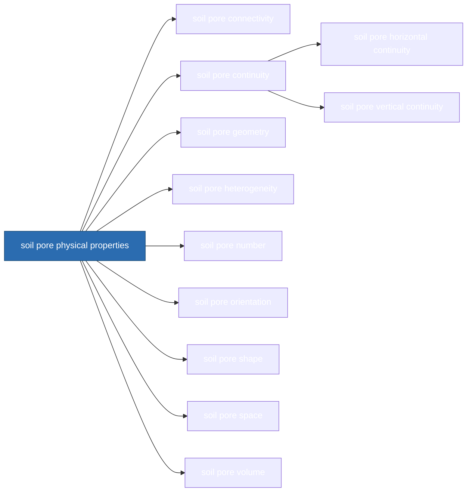

## soil properties / soil chemicophysical properties / soil physical properties / soil types

Path: soil properties › soil chemicophysical properties › soil physical properties › soil types · 173 concepts

```mermaid
flowchart LR
    n254["soil types"]:::root
    n318["anthropogenic soils"]
    n254 --> n318
    n319["eroded soils"]
    n318 --> n319
    n320["paddy soils"]
    n318 --> n320
    n321["polder soils"]
    n318 --> n321
    n322["polluted soils"]
    n318 --> n322
    n323["reclaimed soils"]
    n318 --> n323
    n324["roadside soils"]
    n318 --> n324
    n325["chemical soil types"]
    n254 --> n325
    n326["acid soils"]
    n325 --> n326
    n327["acid sulphate soils"]
    n325 --> n327
    n328["alkaline soils"]
    n325 --> n328
    n329["calcareous soils"]
    n325 --> n329
    n330["gypsiferous soils"]
    n325 --> n330
    n331["mineral soils"]
    n325 --> n331
    n332["neutral soils"]
    n325 --> n332
    n333["organic soils"]
    n325 --> n333
    n334["peat soils"]
    n325 --> n334
    n335["saline sodic soils"]
    n325 --> n335
    n336["saline soils"]
    n325 --> n336
    n337["Solonchaks"]
    n336 --> n337
    n338["sodic soils"]
    n325 --> n338
    n339["water repellent soils"]
    n325 --> n339
    n340["climatic soil types"]
    n254 --> n340
    n341["arid soils"]
    n340 --> n341
    n342["desert soils"]
    n340 --> n342
    n343["frigid soils"]
    n340 --> n343
    n344["semi-arid soils"]
    n340 --> n344
    n345["subtropical soils"]
    n340 --> n345
    n346["tropical soils"]
    n340 --> n346
    n347["xeric soils"]
    n340 --> n347
    n348["cultural soil types"]
    n254 --> n348
    n349["agricultural soils"]
    n348 --> n349
    n350["arable soils"]
    n348 --> n350
    n351["greenhouse soils"]
    n348 --> n351
    n352["horticultural soils"]
    n348 --> n352
    n353["irrigated soils"]
    n348 --> n353
    n354["meadow soils"]
    n348 --> n354
    n355["orchard soils"]
    n348 --> n355
    n356["ecological soil types"]
    n254 --> n356
    n357["bog soils"]
    n356 --> n357
    n358["forest soils"]
    n356 --> n358
    n359["grassland soils"]
    n356 --> n359
    n360["heathland soils"]
    n356 --> n360
    n361["marshland soils"]
    n356 --> n361
    n362["prairie soils"]
    n356 --> n362
    n363["rangeland soils"]
    n356 --> n363
    n364["scrubland soils"]
    n356 --> n364
    n365["swamp soils"]
    n356 --> n365
    n366["virgin soils"]
    n356 --> n366
    n367["wetland soils"]
    n356 --> n367
    n368["genetic soil types (75 concepts)"]:::more
    n254 --> n368
    n369["layered soils"]
    n254 --> n369
    n370["lithological soil types"]
    n254 --> n370
    n371["alluvial soils"]
    n370 --> n371
    n372["basaltic soils"]
    n370 --> n372
    n373["boulder clay soils"]
    n370 --> n373
    n374["chalk soils"]
    n370 --> n374
    n375["clay soils"]
    n370 --> n375
    n376["diorite soils"]
    n370 --> n376
    n377["glacial till soils"]
    n370 --> n377
    n378["granite soils"]
    n370 --> n378
    n379["greywacke soils"]
    n370 --> n379
    n380["igneous rock soils"]
    n370 --> n380
    n381["serpentine soils"]
    n380 --> n381
    n382["loess soils"]
    n370 --> n382
    n383["sandy soils"]
    n370 --> n383
    n384["schist soils"]
    n370 --> n384
    n385["shale soils"]
    n370 --> n385
    n386["volcanic soils"]
    n370 --> n386
    n387["mineralogical soil types"]
    n254 --> n387
    n388["calamine soils"]
    n387 --> n388
    n389["illitic soils"]
    n387 --> n389
    n390["montmorillonitic soils"]
    n387 --> n390
    n391["palaeosolic soil types"]
    n254 --> n391
    n392["buried soils"]
    n391 --> n392
    n393["palaeosols"]
    n391 --> n393
    n394["physiographic soil types"]
    n254 --> n394
    n395["bottomland soils"]
    n394 --> n395
    n396["coastal soils"]
    n394 --> n396
    n397["delta soils"]
    n394 --> n397
    n398["drumlin soils"]
    n394 --> n398
    n399["dune soils"]
    n394 --> n399
    n400["fenland soils"]
    n394 --> n400
    n401["hill soils"]
    n394 --> n401
    n402["karst soils"]
    n394 --> n402
    n403["moraine soils"]
    n394 --> n403
    n404["mountain soils"]
    n394 --> n404
    n405["river terrace soils"]
    n394 --> n405
    n406["upland soils"]
    n394 --> n406
    n407["polygenetic soil types"]
    n254 --> n407
    n408["stratigraphic soil types"]
    n254 --> n408
    n409["structural soil types"]
    n254 --> n409
    n410["claypan soils"]
    n409 --> n410
    n411["dispersive soils"]
    n409 --> n411
    n412["textural soil types"]
    n254 --> n412
    n413["loam soils"]
    n412 --> n413
    n414["silty soils"]
    n412 --> n414
    n415["stony soils"]
    n412 --> n415
    classDef root fill:#2b6cb0,color:#fff,stroke:#1a4971
    classDef more fill:#f6ad55,stroke:#c05621
```

Collapsed branches:
- [genetic soil types](#soil-properties--soil-chemicophysical-properties--soil-physical-properties--soil-types--genetic-soil-types) (75)

## soil properties / soil chemicophysical properties / soil physical properties / soil types / genetic soil types

Path: soil properties › soil chemicophysical properties › soil physical properties › soil types › genetic soil types · 75 concepts

```mermaid
flowchart LR
    n368["genetic soil types"]:::root
    n416["hydromorphic soils"]
    n368 --> n416
    n417["soil classification"]
    n368 --> n417
    n418["soil classification FAO"]
    n417 --> n418
    n419["Acrisols"]
    n418 --> n419
    n420["Andosols"]
    n418 --> n420
    n421["Arenosols"]
    n418 --> n421
    n422["Cambisols"]
    n418 --> n422
    n423["Chernozems"]
    n418 --> n423
    n424["Ferralsols"]
    n418 --> n424
    n425["Fluvisols"]
    n418 --> n425
    n426["Gleysols"]
    n418 --> n426
    n427["greyzems"]
    n418 --> n427
    n428["Histosols"]
    n418 --> n428
    n429["Kastanozems"]
    n418 --> n429
    n430["lithosols"]
    n418 --> n430
    n431["Luvisols"]
    n418 --> n431
    n432["Nitosols"]
    n418 --> n432
    n433["Phaeozems"]
    n418 --> n433
    n434["Planosols"]
    n418 --> n434
    n435["Podzols"]
    n418 --> n435
    n436["podzoluvisols"]
    n418 --> n436
    n437["rankers"]
    n418 --> n437
    n438["Regosols"]
    n418 --> n438
    n439["rendzinas"]
    n418 --> n439
    n440["Solonchaks"]
    n418 --> n440
    n441["Solonetz"]
    n418 --> n441
    n442["Vertisols"]
    n418 --> n442
    n443["xerosols"]
    n418 --> n443
    n444["yermosols"]
    n418 --> n444
    n445["soil classification USDA"]
    n417 --> n445
    n446["Alfisols"]
    n445 --> n446
    n447["Andisols"]
    n445 --> n447
    n448["Aridisols"]
    n445 --> n448
    n449["Entisols"]
    n445 --> n449
    n450["Gelisols"]
    n445 --> n450
    n451["Histosols"]
    n445 --> n451
    n452["Inceptisols"]
    n445 --> n452
    n453["Mollisols"]
    n445 --> n453
    n454["Oxisols"]
    n445 --> n454
    n455["Spodosols"]
    n445 --> n455
    n456["Ultisols"]
    n445 --> n456
    n457["Vertisols"]
    n445 --> n457
    n458["soil classification WRB"]
    n417 --> n458
    n459["Acrisols"]
    n458 --> n459
    n460["Alisols"]
    n458 --> n460
    n461["Andosols"]
    n458 --> n461
    n462["Anthrosols"]
    n458 --> n462
    n463["Arenosols"]
    n458 --> n463
    n464["Calcisols"]
    n458 --> n464
    n465["Cambisols"]
    n458 --> n465
    n466["Chernozems"]
    n458 --> n466
    n467["Cryosols"]
    n458 --> n467
    n468["Durisols"]
    n458 --> n468
    n469["Ferralsols"]
    n458 --> n469
    n470["Fluvisols"]
    n458 --> n470
    n471["Gleysols"]
    n458 --> n471
    n472["Gypsisols"]
    n458 --> n472
    n473["Histosols"]
    n458 --> n473
    n474["Kastanozems"]
    n458 --> n474
    n475["Leptosols"]
    n458 --> n475
    n476["Lixisols"]
    n458 --> n476
    n477["Luvisols"]
    n458 --> n477
    n478["Nitosols"]
    n458 --> n478
    n479["Phaeozems"]
    n458 --> n479
    n480["Planosols"]
    n458 --> n480
    n481["Plinthosols"]
    n458 --> n481
    n482["Podzols"]
    n458 --> n482
    n483["Regosols"]
    n458 --> n483
    n484["Retisols"]
    n458 --> n484
    n485["Solonetz"]
    n458 --> n485
    n486["Stagnosols"]
    n458 --> n486
    n487["Technosols"]
    n458 --> n487
    n488["Umbrisols"]
    n458 --> n488
    n489["Vertisols"]
    n458 --> n489
    classDef root fill:#2b6cb0,color:#fff,stroke:#1a4971
    classDef more fill:#f6ad55,stroke:#c05621
```

## soil properties / soil chemicophysical properties / soil physical properties / soil water physical properties

Path: soil properties › soil chemicophysical properties › soil physical properties › soil water physical properties · 20 concepts

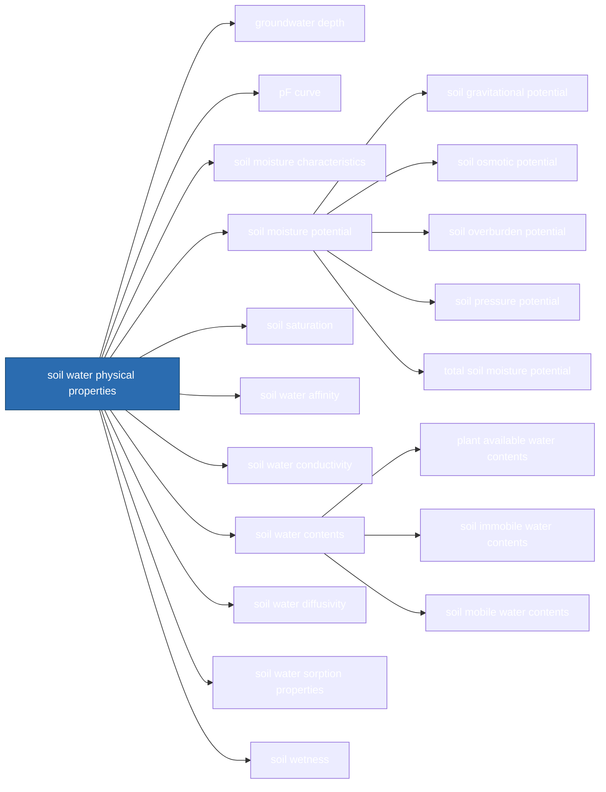

## soil substance

Path: soil substance · 147 concepts

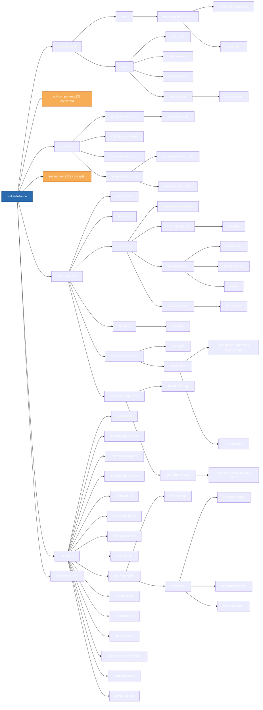

Collapsed branches:
- [soil components](#soil-substance--soil-components) (39)
- [soil nutrients](#soil-substance--soil-nutrients) (42)

## soil substance / soil components

Path: soil substance › soil components · 39 concepts

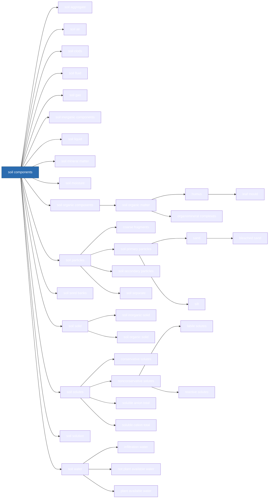

## soil substance / soil nutrients

Path: soil substance › soil nutrients · 42 concepts

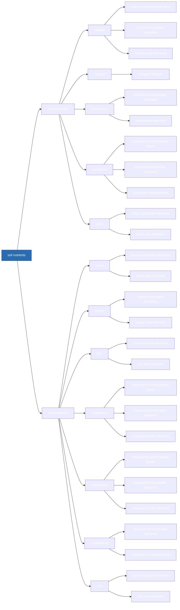

## soil processes

Path: soil processes · 144 concepts

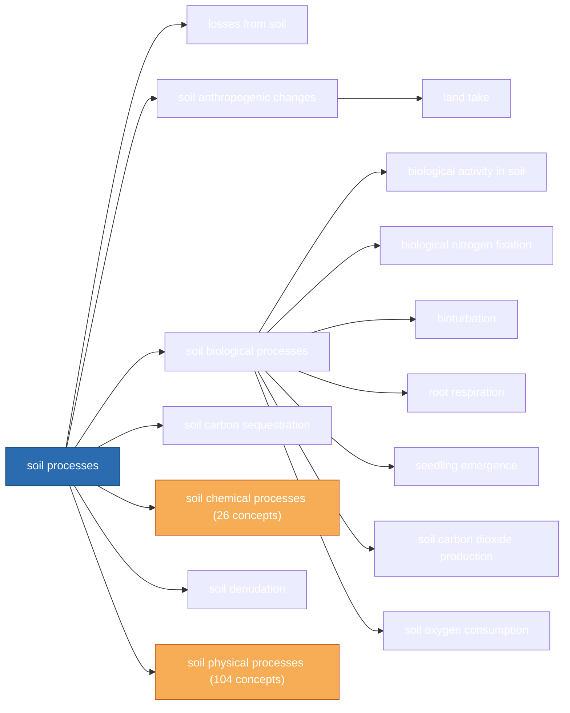

Collapsed branches:
- [soil chemical processes](#soil-processes--soil-chemical-processes) (26)
- [soil physical processes](#soil-processes--soil-physical-processes) (104)

## soil processes / soil chemical processes

Path: soil processes › soil chemical processes · 26 concepts

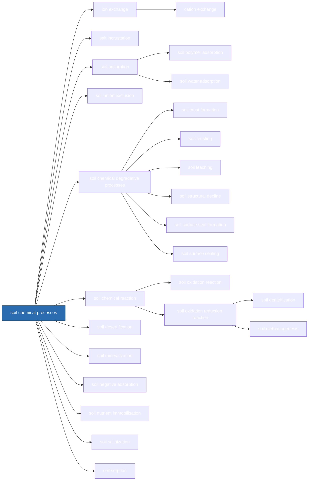

## soil processes / soil physical processes

Path: soil processes › soil physical processes · 104 concepts

```mermaid
flowchart LR
    n671["soil physical processes"]:::root
    n697["soil absorption"]
    n671 --> n697
    n698["soil heat absorption"]
    n697 --> n698
    n699["soil water absorption"]
    n697 --> n699
    n700["soil aggregate dispersion"]
    n671 --> n700
    n701["soil aggregation"]
    n671 --> n701
    n702["soil air physical processes"]
    n671 --> n702
    n703["soil air exchange"]
    n702 --> n703
    n704["soil air movement"]
    n702 --> n704
    n705["soil air flow"]
    n704 --> n705
    n706["soil air convection"]
    n705 --> n706
    n707["soil air convective flow"]
    n705 --> n707
    n708["soil air diffusion"]
    n705 --> n708
    n709["soil gaseous exchange"]
    n702 --> n709
    n710["soil deformation"]
    n671 --> n710
    n711["soil collapsing"]
    n710 --> n711
    n712["soil permanent deformation"]
    n710 --> n712
    n713["soil strain"]
    n710 --> n713
    n714["soil longitudinal strain"]
    n713 --> n714
    n715["soil shear strain"]
    n713 --> n715
    n716["soil tangential strain"]
    n713 --> n716
    n717["soil volume change"]
    n710 --> n717
    n718["soil shrinkage"]
    n717 --> n718
    n719["normal shrinkage"]
    n718 --> n719
    n720["residual shrinkage"]
    n718 --> n720
    n721["soil shrinking"]
    n717 --> n721
    n722["soil swelling"]
    n717 --> n722
    n723["interlattice swelling"]
    n722 --> n723
    n724["interparticle swelling"]
    n722 --> n724
    n725["soil densification"]
    n671 --> n725
    n726["soil compression"]
    n725 --> n726
    n727["soil consolidation"]
    n726 --> n727
    n728["soil hardsetting"]
    n725 --> n728
    n729["soil dispersion"]
    n671 --> n729
    n730["soil flocculation"]
    n671 --> n730
    n731["soil formation"]
    n671 --> n731
    n732["soil accumulation"]
    n731 --> n732
    n733["soil movement"]
    n671 --> n733
    n734["frost heave"]
    n733 --> n734
    n735["mass movement"]
    n733 --> n735
    n736["mud flows"]
    n733 --> n736
    n737["pedoturbation"]
    n733 --> n737
    n738["gas turbation"]
    n737 --> n738
    n739["slipping of soil"]
    n733 --> n739
    n740["soil fluid movement"]
    n733 --> n740
    n741["soil particle movement"]
    n733 --> n741
    n742["soil structural movement"]
    n733 --> n742
    n743["soil subsidence"]
    n733 --> n743
    n744["soil settlement"]
    n743 --> n744
    n745["solifluction"]
    n733 --> n745
    n746["soil physical degradative processes"]
    n671 --> n746
    n747["soil retention"]
    n671 --> n747
    n748["soil fluid retention"]
    n747 --> n748
    n749["soil nutrient retention"]
    n747 --> n749
    n750["soil nutrient storage"]
    n747 --> n750
    n751["soil water retention"]
    n747 --> n751
    n752["soil water storage"]
    n747 --> n752
    n753["soil sedimentation"]
    n671 --> n753
    n754["soil slaking"]
    n671 --> n754
    n755["soil structural change"]
    n671 --> n755
    n756["soil thermal processes"]
    n671 --> n756
    n757["soil heat exchange"]
    n756 --> n757
    n758["soil heat movement"]
    n756 --> n758
    n759["soil heat transfer"]
    n758 --> n759
    n760["soil heat conduction"]
    n759 --> n760
    n761["soil heat convection"]
    n759 --> n761
    n762["soil heat radiation"]
    n759 --> n762
    n763["soil heat transport"]
    n758 --> n763
    n764["soil warming"]
    n756 --> n764
    n765["soil transport"]
    n671 --> n765
    n766["ion transport in soil"]
    n765 --> n766
    n767["soil fluid transmission"]
    n765 --> n767
    n768["soil fluid transport"]
    n765 --> n768
    n769["soil pollutant transport"]
    n765 --> n769
    n770["soil solid transport"]
    n765 --> n770
    n771["soil solute transport"]
    n765 --> n771
    n772["soil solute convection"]
    n771 --> n772
    n773["soil solute convective transport"]
    n771 --> n773
    n774["soil solute diffusion"]
    n771 --> n774
    n775["soil solute diffusive transport"]
    n771 --> n775
    n776["soil solute dispersion"]
    n771 --> n776
    n777["soil solute dispersive transport"]
    n771 --> n777
    n778["longitudinal dispersion"]
    n777 --> n778
    n779["transverse dispersion"]
    n777 --> n779
    n780["soil water movement"]
    n765 --> n780
    n781["soil water flow"]
    n780 --> n781
    n782["saturated water flow"]
    n781 --> n782
    n783["unsaturated water flow"]
    n781 --> n783
    n784["soil water transport"]
    n780 --> n784
    n785["soil water transmission"]
    n765 --> n785
    n786["soil water physical processes"]
    n671 --> n786
    n787["soil drying"]
    n786 --> n787
    n788["soil desiccation"]
    n787 --> n788
    n789["soil rapid drying"]
    n787 --> n789
    n790["soil slow drying"]
    n787 --> n790
    n791["soil freezing"]
    n786 --> n791
    n792["soil melting"]
    n786 --> n792
    n793["soil moisture movement"]
    n786 --> n793
    n794["soil thawing"]
    n786 --> n794
    n795["soil water condensation"]
    n786 --> n795
    n796["soil water loss"]
    n786 --> n796
    n797["soil wetting"]
    n786 --> n797
    n798["soil rapid wetting"]
    n797 --> n798
    n799["soil slow wetting"]
    n797 --> n799
    classDef root fill:#2b6cb0,color:#fff,stroke:#1a4971
    classDef more fill:#f6ad55,stroke:#c05621
```

## soil management

Path: soil management · 96 concepts

```mermaid
flowchart LR
    n800["soil management"]:::root
    n801["fertiliser use"]
    n800 --> n801
    n802["integrated soil fertility management"]
    n800 --> n802
    n803["irrigation"]
    n800 --> n803
    n804["liming"]
    n800 --> n804
    n805["mulch"]
    n800 --> n805
    n806["crop residue mulch"]
    n805 --> n806
    n807["dry mulches"]
    n805 --> n807
    n808["aluminium mulches"]
    n807 --> n808
    n809["gravel mulches"]
    n807 --> n809
    n810["plastic mulches"]
    n807 --> n810
    n811["soil mulches"]
    n807 --> n811
    n812["organic mulches"]
    n805 --> n812
    n813["bark mulches"]
    n812 --> n813
    n814["compost mulches"]
    n812 --> n814
    n815["leaf mulches"]
    n812 --> n815
    n816["live mulches"]
    n812 --> n816
    n817["straw mulches"]
    n812 --> n817
    n818["wood chips mulches"]
    n812 --> n818
    n819["mulch farming"]
    n800 --> n819
    n820["mulching"]
    n800 --> n820
    n821["no till"]
    n800 --> n821
    n822["pesticide use"]
    n800 --> n822
    n823["salinity control"]
    n800 --> n823
    n824["seedbed preparation"]
    n800 --> n824
    n825["site preparation"]
    n800 --> n825
    n826["microsite preparation"]
    n825 --> n826
    n827["soil amendments"]
    n800 --> n827
    n828["evaporation suppressants"]
    n827 --> n828
    n829["inorganic amendments"]
    n827 --> n829
    n830["liming materials"]
    n827 --> n830
    n831["agricultural lime"]
    n830 --> n831
    n832["calcitic lime (amendment)"]
    n830 --> n832
    n833["dolomitic lime (amendment)"]
    n830 --> n833
    n834["lime (amendment)"]
    n830 --> n834
    n835["organic amendments"]
    n827 --> n835
    n836["soil conditioners"]
    n827 --> n836
    n837["soil conservation"]
    n800 --> n837
    n838["erosion control"]
    n837 --> n838
    n839["erosion control plants"]
    n838 --> n839
    n840["gully control"]
    n838 --> n840
    n841["in situ soil conservation"]
    n837 --> n841
    n842["soil conservation legislation"]
    n837 --> n842
    n843["soil stabilization"]
    n837 --> n843
    n844["dune fixation"]
    n843 --> n844
    n845["soil drainage"]
    n800 --> n845
    n846["biodrainage"]
    n845 --> n846
    n847["controlled drainage"]
    n845 --> n847
    n848["conventional drainage"]
    n845 --> n848
    n849["pipe drainage"]
    n845 --> n849
    n850["subsurface drainage"]
    n845 --> n850
    n851["surface drainage"]
    n845 --> n851
    n852["tile drainage"]
    n845 --> n852
    n853["underdrainage"]
    n845 --> n853
    n854["soil improvement"]
    n800 --> n854
    n855["land rehabilitation"]
    n854 --> n855
    n856["soil management equipment"]
    n800 --> n856
    n857["drainage equipment"]
    n856 --> n857
    n858["soil injectors"]
    n856 --> n858
    n859["soil reclamation"]
    n800 --> n859
    n860["soil reclamation plants"]
    n859 --> n860
    n861["soil tillage"]
    n800 --> n861
    n862["conservation tillage"]
    n861 --> n862
    n863["minimum tillage"]
    n862 --> n863
    n864["ridge tillage"]
    n862 --> n864
    n865["strip tillage"]
    n862 --> n865
    n866["stubble tillage"]
    n862 --> n866
    n867["conventional tillage"]
    n861 --> n867
    n868["deep tillage"]
    n861 --> n868
    n869["disking"]
    n861 --> n869
    n870["field preparation"]
    n861 --> n870
    n871["main field preparation"]
    n870 --> n871
    n872["nursery bed preparation"]
    n870 --> n872
    n873["harrowing"]
    n861 --> n873
    n874["planking"]
    n861 --> n874
    n875["ploughing"]
    n861 --> n875
    n876["deep ploughing"]
    n875 --> n876
    n877["primary tillage"]
    n861 --> n877
    n878["ripping (tillage)"]
    n861 --> n878
    n879["rotary cultivation"]
    n861 --> n879
    n880["secondary tillage"]
    n861 --> n880
    n881["soil breaking"]
    n861 --> n881
    n882["soil puddling"]
    n861 --> n882
    n883["soil scarification"]
    n861 --> n883
    n884["stone clearing"]
    n861 --> n884
    n885["subsoiling"]
    n861 --> n885
    n886["surface cultivation"]
    n861 --> n886
    n887["soil treatment"]
    n800 --> n887
    n888["radioactive decontamination (soil)"]
    n887 --> n888
    n889["soil disinfection"]
    n887 --> n889
    n890["soil fumigation"]
    n887 --> n890
    n891["soil heating"]
    n887 --> n891
    n892["soil injection"]
    n887 --> n892
    n893["soil inoculation"]
    n887 --> n893
    n894["soil solarization"]
    n887 --> n894
    n895["soil sterilization"]
    n887 --> n895
    classDef root fill:#2b6cb0,color:#fff,stroke:#1a4971
    classDef more fill:#f6ad55,stroke:#c05621
```

## soil indicators

Path: soil indicators · 64 concepts

```mermaid
flowchart LR
    n896["soil indicators"]:::root
    n897["non-soil indicators"]
    n896 --> n897
    n898["environmental factors"]
    n897 --> n898
    n899["external factors"]
    n897 --> n899
    n900["emissions"]
    n899 --> n900
    n901["inputs"]
    n899 --> n901
    n902["land use"]
    n899 --> n902
    n903["land use bare cover"]
    n902 --> n903
    n904["land use forests"]
    n902 --> n904
    n905["land use grasses"]
    n902 --> n905
    n906["land use shrubs"]
    n902 --> n906
    n907["soil function indicators"]
    n896 --> n907
    n908["biomass productivity"]
    n907 --> n908
    n909["carbon storage capacity"]
    n907 --> n909
    n910["groundwater reproduction"]
    n907 --> n910
    n911["habitat provision capacity"]
    n907 --> n911
    n912["nutrient buffering capacity"]
    n907 --> n912
    n913["nutrient mobilisation capacity"]
    n907 --> n913
    n914["soil moisture deficit"]
    n907 --> n914
    n915["water storage capacity"]
    n907 --> n915
    n916["soil structure index"]
    n896 --> n916
    n917["soil aeration index"]
    n916 --> n917
    n918["soil air diffusion coefficient"]
    n917 --> n918
    n919["soil oxygen diffusion rate"]
    n917 --> n919
    n920["soil aggregation index"]
    n916 --> n920
    n921["geometric mean diametre"]
    n920 --> n921
    n922["mean weight diametre"]
    n920 --> n922
    n923["percent water stable aggregation"]
    n920 --> n923
    n924["soil aggregate size distribution"]
    n920 --> n924
    n925["soil aggregate strength"]
    n920 --> n925
    n926["soil pore tortuosity"]
    n916 --> n926
    n927["soil porosity index"]
    n916 --> n927
    n928["aeration porosity"]
    n927 --> n928
    n929["soil pore size distribution"]
    n927 --> n929
    n930["soil strength index"]
    n916 --> n930
    n931["modulus of rupture"]
    n930 --> n931
    n932["soil relative density"]
    n930 --> n932
    n933["soil structure indirect index"]
    n916 --> n933
    n934["aggregated silt clay"]
    n933 --> n934
    n935["clay ratio"]
    n933 --> n935
    n936["critical soil organic matter contents"]
    n933 --> n936
    n937["dispersion ratio"]
    n933 --> n937
    n938["index based on texture and cementing agents"]
    n933 --> n938
    n939["index of crusting"]
    n933 --> n939
    n940["index of resistance"]
    n933 --> n940
    n941["index of structural stability"]
    n933 --> n941
    n942["mechanical ratio"]
    n933 --> n942
    n943["soil erodibility index"]
    n933 --> n943
    n944["colloid content moisture equivalent ratio"]
    n943 --> n944
    n945["erosion ratio"]
    n943 --> n945
    n946["index of erodibility"]
    n943 --> n946
    n947["silica sesquioxide ratio"]
    n943 --> n947
    n948["surface aggregation ratio"]
    n933 --> n948
    n949["soil water retention index"]
    n916 --> n949
    n950["plant available water capacity"]
    n949 --> n950
    n951["soil water transmission index"]
    n916 --> n951
    n952["soil hydraulic conductivity"]
    n951 --> n952
    n953["saturated hydraulic conductivity"]
    n952 --> n953
    n954["unsaturated hydraulic conductivity"]
    n952 --> n954
    n955["soil hydraulic gradient"]
    n951 --> n955
    n956["soil water evapouration rate"]
    n951 --> n956
    n957["soil water infiltration capacity"]
    n951 --> n957
    n958["soil water infiltration rate"]
    n951 --> n958
    n959["soil water infiltration rate numeric"]
    n958 --> n959
    classDef root fill:#2b6cb0,color:#fff,stroke:#1a4971
    classDef more fill:#f6ad55,stroke:#c05621
```

## soil threats

Path: soil threats · 63 concepts

```mermaid
flowchart LR
    n960["soil threats"]:::root
    n961["soil acidification"]
    n960 --> n961
    n962["soil biodiversity loss"]
    n960 --> n962
    n963["soil compaction"]
    n960 --> n963
    n964["soil deficiencies"]
    n960 --> n964
    n965["soil exhaustion"]
    n964 --> n965
    n966["soil degradation"]
    n960 --> n966
    n967["soil biological degradation"]
    n966 --> n967
    n968["soil chemical degradation"]
    n966 --> n968
    n969["soil ecological degradation"]
    n966 --> n969
    n970["soil physical degradation"]
    n966 --> n970
    n971["soil salinisation"]
    n966 --> n971
    n972["soil sickness"]
    n966 --> n972
    n973["soil erosion"]
    n960 --> n973
    n974["accelerated erosion"]
    n973 --> n974
    n975["anthropogenic erosion"]
    n973 --> n975
    n976["harvesting erosion"]
    n975 --> n976
    n977["livestock trampling erosion"]
    n975 --> n977
    n978["soil erosion activity period"]
    n973 --> n978
    n979["soil erosion area affected"]
    n973 --> n979
    n980["soil erosion category"]
    n973 --> n980
    n981["soil erosion degree"]
    n973 --> n981
    n982["soil erosion total area affected"]
    n973 --> n982
    n983["tillage erosion"]
    n973 --> n983
    n984["water erosion"]
    n973 --> n984
    n985["ephemeral gully erosion"]
    n984 --> n985
    n986["gully erosion"]
    n984 --> n986
    n987["interrill erosion"]
    n984 --> n987
    n988["piping erosion"]
    n984 --> n988
    n989["rill erosion"]
    n984 --> n989
    n990["sheet erosion"]
    n984 --> n990
    n991["splash erosion"]
    n984 --> n991
    n992["wind erosion"]
    n973 --> n992
    n993["soil nutrient loss"]
    n960 --> n993
    n994["soil nitrogen loss"]
    n993 --> n994
    n995["soil phosphorus loss"]
    n993 --> n995
    n996["soil organic carbon loss"]
    n960 --> n996
    n997["soil pollution"]
    n960 --> n997
    n998["soil pollutants"]
    n997 --> n998
    n999["aluminium"]
    n998 --> n999
    n1000["aluminium exchangeable base"]
    n999 --> n1000
    n1001["aluminium extractable elements"]
    n999 --> n1001
    n1002["aluminium total elements"]
    n999 --> n1002
    n1003["antimony"]
    n998 --> n1003
    n1004["arsenic"]
    n998 --> n1004
    n1005["cadmium"]
    n998 --> n1005
    n1006["cadmium extractable elements"]
    n1005 --> n1006
    n1007["cadmium total elements"]
    n1005 --> n1007
    n1008["chromium"]
    n998 --> n1008
    n1009["cobalt"]
    n998 --> n1009
    n1010["lead"]
    n998 --> n1010
    n1011["mercury"]
    n998 --> n1011
    n1012["microplastics"]
    n998 --> n1012
    n1013["nanoplastics"]
    n1012 --> n1013
    n1014["nickel"]
    n998 --> n1014
    n1015["perfluoroalkyl acids"]
    n998 --> n1015
    n1016["polychlorinated biphenyls"]
    n998 --> n1016
    n1017["polycyclic aromatic hydrocarbons"]
    n998 --> n1017
    n1018["vanadium"]
    n998 --> n1018
    n1019["soil sealing"]
    n960 --> n1019
    n1020["soil sealing consistence"]
    n1019 --> n1020
    n1021["soil sealing thickness"]
    n1019 --> n1021
    n1022["waterlogging"]
    n960 --> n1022
    classDef root fill:#2b6cb0,color:#fff,stroke:#1a4971
    classDef more fill:#f6ad55,stroke:#c05621
```

## soil description

Path: soil description · 42 concepts

```mermaid
flowchart LR
    n1023["soil description"]:::root
    n1024["crop class"]
    n1023 --> n1024
    n1025["fragment class"]
    n1023 --> n1025
    n1026["human influence class"]
    n1023 --> n1026
    n1027["koeppen class"]
    n1023 --> n1027
    n1028["land use class"]
    n1023 --> n1028
    n1029["pedon"]
    n1023 --> n1029
    n1030["porosity class"]
    n1023 --> n1030
    n1031["profile description status"]
    n1023 --> n1031
    n1032["slope gradient class"]
    n1023 --> n1032
    n1033["slope orientation class"]
    n1023 --> n1033
    n1034["soil depth rootable class"]
    n1023 --> n1034
    n1035["soil information"]
    n1023 --> n1035
    n1036["soil maps"]
    n1035 --> n1036
    n1037["soil landscapes"]
    n1023 --> n1037
    n1038["soil morphological features"]
    n1023 --> n1038
    n1039["soil horizons"]
    n1038 --> n1039
    n1040["A horizons"]
    n1039 --> n1040
    n1041["B horizons"]
    n1039 --> n1041
    n1042["C horizons"]
    n1039 --> n1042
    n1043["diagnostic horizons"]
    n1039 --> n1043
    n1044["E horizons"]
    n1039 --> n1044
    n1045["hardpans"]
    n1039 --> n1045
    n1046["organic horizons"]
    n1039 --> n1046
    n1047["spodic horizons"]
    n1039 --> n1047
    n1048["soil micromorphological features"]
    n1038 --> n1048
    n1049["soil profiles"]
    n1038 --> n1049
    n1050["wheel tracks"]
    n1038 --> n1050
    n1051["soil organic matter class"]
    n1023 --> n1051
    n1052["soil sequences"]
    n1023 --> n1052
    n1053["soil surveys"]
    n1023 --> n1053
    n1054["digital soil mapping"]
    n1053 --> n1054
    n1055["soil analysis"]
    n1053 --> n1055
    n1056["soil investigations"]
    n1053 --> n1056
    n1057["soil exposure types"]
    n1056 --> n1057
    n1058["soil sampling"]
    n1053 --> n1058
    n1059["soil survey guidelines"]
    n1053 --> n1059
    n1060["soil water infiltration rate class"]
    n1023 --> n1060
    n1061["soil zonation"]
    n1023 --> n1061
    n1062["texture field class"]
    n1023 --> n1062
    n1063["texture lab class"]
    n1023 --> n1063
    n1064["vegetation class"]
    n1023 --> n1064
    classDef root fill:#2b6cb0,color:#fff,stroke:#1a4971
    classDef more fill:#f6ad55,stroke:#c05621
```

## soil functions

Path: soil functions · 39 concepts

```mermaid
flowchart LR
    n1065["soil functions"]:::root
    n1066["carbon pools"]
    n1065 --> n1066
    n1067["climate regulation"]
    n1065 --> n1067
    n1068["food production"]
    n1065 --> n1068
    n1069["habitats"]
    n1065 --> n1069
    n1070["nutrient dynamics"]
    n1065 --> n1070
    n1071["soil agricultural functions"]
    n1065 --> n1071
    n1072["agricultural sustainability"]
    n1071 --> n1072
    n1073["crop yield"]
    n1071 --> n1073
    n1074["plant nutrient uptake"]
    n1071 --> n1074
    n1075["plant respiration"]
    n1071 --> n1075
    n1076["plant water uptake"]
    n1071 --> n1076
    n1077["root growth"]
    n1071 --> n1077
    n1078["soil aeration"]
    n1071 --> n1078
    n1079["soil chemical transport"]
    n1071 --> n1079
    n1080["soil microbial activity"]
    n1071 --> n1080
    n1081["soil microbial respiration"]
    n1080 --> n1081
    n1082["soil respiration"]
    n1071 --> n1082
    n1083["soil water availability"]
    n1071 --> n1083
    n1084["soil biological functions"]
    n1065 --> n1084
    n1085["soil chemical functions"]
    n1065 --> n1085
    n1086["soil engineering functions"]
    n1065 --> n1086
    n1087["building stability"]
    n1086 --> n1087
    n1088["filtration"]
    n1086 --> n1088
    n1089["foundation stability"]
    n1086 --> n1089
    n1090["foundation strength"]
    n1086 --> n1090
    n1091["pavement stability"]
    n1086 --> n1091
    n1092["soil bearing capacity"]
    n1086 --> n1092
    n1093["soil seepage"]
    n1086 --> n1093
    n1094["waste disposal"]
    n1086 --> n1094
    n1095["liquid waste disposal"]
    n1094 --> n1095
    n1096["water quality"]
    n1086 --> n1096
    n1097["soil environmental functions"]
    n1065 --> n1097
    n1098["air quality"]
    n1097 --> n1098
    n1099["soil gaseous emission"]
    n1097 --> n1099
    n1100["soil physical functions"]
    n1065 --> n1100
    n1101["water purification"]
    n1065 --> n1101
    n1102["water filtration (soil)"]
    n1101 --> n1102
    n1103["water regulation"]
    n1065 --> n1103
    classDef root fill:#2b6cb0,color:#fff,stroke:#1a4971
    classDef more fill:#f6ad55,stroke:#c05621
```

## planetary phenomena

Path: planetary phenomena · 30 concepts

```mermaid
flowchart LR
    n1104["planetary phenomena"]:::root
    n1105["climate"]
    n1104 --> n1105
    n1106["inundation"]
    n1104 --> n1106
    n1107["floods"]
    n1106 --> n1107
    n1108["flood duration"]
    n1107 --> n1108
    n1109["flood frequency"]
    n1107 --> n1109
    n1110["season"]
    n1104 --> n1110
    n1111["water interchange"]
    n1104 --> n1111
    n1112["evapotranspiration"]
    n1111 --> n1112
    n1113["evapouration"]
    n1111 --> n1113
    n1114["soil water evapouration"]
    n1113 --> n1114
    n1115["interflow"]
    n1111 --> n1115
    n1116["overland flow"]
    n1111 --> n1116
    n1117["percolation"]
    n1111 --> n1117
    n1118["precipitation"]
    n1111 --> n1118
    n1119["fog"]
    n1118 --> n1119
    n1120["hail"]
    n1118 --> n1120
    n1121["mist"]
    n1118 --> n1121
    n1122["rain"]
    n1118 --> n1122
    n1123["sleet"]
    n1118 --> n1123
    n1124["snow"]
    n1118 --> n1124
    n1125["runoff"]
    n1111 --> n1125
    n1126["surface runoff"]
    n1125 --> n1126
    n1127["soil water infiltration"]
    n1111 --> n1127
    n1128["flux controlled water infiltration"]
    n1127 --> n1128
    n1129["profile controlled water infiltration"]
    n1127 --> n1129
    n1130["transpiration"]
    n1111 --> n1130
    n1131["weather"]
    n1104 --> n1131
    n1132["weather current"]
    n1131 --> n1132
    n1133["weather past"]
    n1131 --> n1133
    classDef root fill:#2b6cb0,color:#fff,stroke:#1a4971
    classDef more fill:#f6ad55,stroke:#c05621
```

## land cover

Path: land cover · 15 concepts

```mermaid
flowchart LR
    n1134["land cover"]:::root
    n1135["building"]
    n1134 --> n1135
    n1136["ground cover"]
    n1134 --> n1136
    n1137["pavements"]
    n1134 --> n1137
    n1138["road"]
    n1137 --> n1138
    n1139["plant cover"]
    n1134 --> n1139
    n1140["crop"]
    n1139 --> n1140
    n1141["plant part"]
    n1139 --> n1141
    n1142["roots"]
    n1141 --> n1142
    n1143["root abundance"]
    n1142 --> n1143
    n1144["root presence"]
    n1142 --> n1144
    n1145["vegetation"]
    n1139 --> n1145
    n1146["grasses"]
    n1145 --> n1146
    n1147["trees"]
    n1145 --> n1147
    n1148["tree density"]
    n1147 --> n1148
    classDef root fill:#2b6cb0,color:#fff,stroke:#1a4971
    classDef more fill:#f6ad55,stroke:#c05621
```

## soil phenomena

Path: soil phenomena · 15 concepts

```mermaid
flowchart LR
    n1149["soil phenomena"]:::root
    n1150["drainage to groundwater"]
    n1149 --> n1150
    n1151["salt sieving"]
    n1149 --> n1151
    n1152["soil failure"]
    n1149 --> n1152
    n1153["soil cracking"]
    n1152 --> n1153
    n1154["soil flow"]
    n1152 --> n1154
    n1155["soil fragmentation"]
    n1152 --> n1155
    n1156["soil rupture"]
    n1152 --> n1156
    n1157["soil hydrophobicity"]
    n1149 --> n1157
    n1158["soil moisture hysteresis"]
    n1149 --> n1158
    n1159["soil moisture redistribution"]
    n1149 --> n1159
    n1160["soil oxygen deficiency"]
    n1149 --> n1160
    n1161["soil strain hardening"]
    n1149 --> n1161
    n1162["soil water repellency"]
    n1149 --> n1162
    n1163["soil–plant–atmosphere continuum"]
    n1149 --> n1163
    classDef root fill:#2b6cb0,color:#fff,stroke:#1a4971
    classDef more fill:#f6ad55,stroke:#c05621
```

## soil sciences

Path: soil sciences · 15 concepts

```mermaid
flowchart LR
    n1164["soil sciences"]:::root
    n1165["agrology"]
    n1164 --> n1165
    n1166["pedology"]
    n1164 --> n1166
    n1167["soil biology"]
    n1164 --> n1167
    n1168["soil chemistry"]
    n1164 --> n1168
    n1169["soil erosion models"]
    n1164 --> n1169
    n1170["Modified Universal Soil Loss Equation"]
    n1169 --> n1170
    n1171["Revised Universal Soil Loss Equation"]
    n1169 --> n1171
    n1172["Universal Soil Loss Equation"]
    n1169 --> n1172
    n1173["soil hydrology"]
    n1164 --> n1173
    n1174["soil mechanics"]
    n1164 --> n1174
    n1175["soil dynamics"]
    n1174 --> n1175
    n1176["soil morphology"]
    n1164 --> n1176
    n1177["soil physics"]
    n1164 --> n1177
    n1178["soil scientists"]
    n1164 --> n1178
    classDef root fill:#2b6cb0,color:#fff,stroke:#1a4971
    classDef more fill:#f6ad55,stroke:#c05621
```

## geology

Path: geology · 13 concepts

```mermaid
flowchart LR
    n1179["geology"]:::root
    n1180["lithology"]
    n1179 --> n1180
    n1181["parent material"]
    n1179 --> n1181
    n1182["alluvium"]
    n1181 --> n1182
    n1183["colluvium"]
    n1181 --> n1183
    n1184["gravel"]
    n1181 --> n1184
    n1185["loess"]
    n1181 --> n1185
    n1186["parent deposition"]
    n1181 --> n1186
    n1187["parent lithology"]
    n1181 --> n1187
    n1188["parent texture unconsolidated"]
    n1181 --> n1188
    n1189["rock outcrops"]
    n1179 --> n1189
    n1190["rock outcrop cover"]
    n1189 --> n1190
    n1191["rock outcrop distance"]
    n1189 --> n1191
    classDef root fill:#2b6cb0,color:#fff,stroke:#1a4971
    classDef more fill:#f6ad55,stroke:#c05621
```

## physiography

Path: physiography · 10 concepts

```mermaid
flowchart LR
    n1192["physiography"]:::root
    n1193["landform complex"]
    n1192 --> n1193
    n1194["major land forms"]
    n1192 --> n1194
    n1195["slope"]
    n1192 --> n1195
    n1196["slope forms"]
    n1195 --> n1196
    n1197["slope gradient"]
    n1195 --> n1197
    n1198["slope gradient numeric"]
    n1197 --> n1198
    n1199["slope orientation"]
    n1195 --> n1199
    n1200["slope orientation numeric"]
    n1199 --> n1200
    n1201["slope pathways"]
    n1195 --> n1201
    classDef root fill:#2b6cb0,color:#fff,stroke:#1a4971
    classDef more fill:#f6ad55,stroke:#c05621
```

## soil

Path: soil · 7 concepts

```mermaid
flowchart LR
    n1202["soil"]:::root
    n1203["fine soil"]
    n1202 --> n1203
    n1204["rhizosphere"]
    n1202 --> n1204
    n1205["soil resources"]
    n1202 --> n1205
    n1206["soil skeleton"]
    n1202 --> n1206
    n1207["subsoil"]
    n1202 --> n1207
    n1208["topsoil"]
    n1202 --> n1208
    classDef root fill:#2b6cb0,color:#fff,stroke:#1a4971
    classDef more fill:#f6ad55,stroke:#c05621
```

## ecosystem services

Path: ecosystem services · 5 concepts

```mermaid
flowchart LR
    n1209["ecosystem services"]:::root
    n1210["cultural services"]
    n1209 --> n1210
    n1211["provisioning services"]
    n1209 --> n1211
    n1212["regulating services"]
    n1209 --> n1212
    n1213["supporting services"]
    n1209 --> n1213
    classDef root fill:#2b6cb0,color:#fff,stroke:#1a4971
    classDef more fill:#f6ad55,stroke:#c05621
```

## soil health

Path: soil health · 1 concepts

```mermaid
flowchart LR
    n1214["soil health"]:::root
    classDef root fill:#2b6cb0,color:#fff,stroke:#1a4971
    classDef more fill:#f6ad55,stroke:#c05621
```
