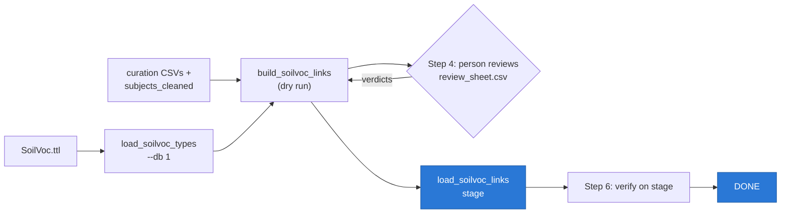

# Implementation: Option 1 — `soilvoc_types` + `subject_soilvoc`

Steps to implement **Option 1 (two tables)** of `PLAN.md`: load SoilVoc into the DB and link
subjects to it, so keyword/subject noise filtering works.

**Target environment: stage only** (`DB_*1` = `msp-kh-stage`, schema `validate`,
credentials from `.env`) — user decision 2026-11-03. The load scripts accept only
`--db 1`; dev is never written. Dev (`DB_*2` = `msp-kh-dev`) was
loaded during the session and then fully reverted; it is back to its original state.

## Status

| Step | State |
|---|---|
| 0 Preconditions | ⚠ partly open — see below |
| 1 DDL (`soilvoc_types`, `subject_soilvoc`) | ✅ done on stage |
| 2 Load `soilvoc_types` (1,464 concepts) | ✅ done on stage |
| 3 Build link set (dry run) | ✅ done — 2,435 links |
| 4 Human review | ⏳ **open** — `review_sheet.csv`, 257 rows |
| 5 Load links + noise marks | ✅ done on stage |
| 6 Verify | ✅ all PLAN numbers match |
| 7 Promote to stage | ✅ (loaded directly on stage) |
| 8 Expose in API/UI | ⬜ not started |
| 9 Harvest integration | ⬜ not started |

All PLAN targets were verified on stage — see **Stage load — final state** below.

## Step 0 — Preconditions

- [x] Option 1 (two tables) chosen — this document, and it is what is loaded
- [x] Target environment: **stage only** (dev load reverted, see execution log)
- [x] `noise` stored in `subjects.vocabulary_name` (no new column) — done as part of Step 5
- [ ] Owner of `raw_metadata.matched_subjects` identified — it lives outside `validate`
      (`harvest`/`metadata` schemas), so align with it to avoid a second, conflicting
      matching (still open, from `PLAN.md`)
- [ ] Step 4 review signed off (see below)

## Step 1 — DDL: create the two tables ✅

No alembic in this repo; `landcover_types`/`record_landcover` are owned by `k2xadmin`,
so create directly as `k2xadmin`, mirroring `landcover_types`.

- Files: `scripts/sql/create_soilvoc_tables.sql`, runner `scripts/create_soilvoc_tables.py`
- Run: `python3 scripts/create_soilvoc_tables.py --db 1`
- Shape: `soilvoc_types(code PK, level, parent_code self-FK, name, alt_labels text[])`
  and `subject_soilvoc(subject_id FK, soilvoc_code FK, link_type, part, reviewed)`
  with `PRIMARY KEY (subject_id, soilvoc_code)`
- Idempotent: `CREATE TABLE IF NOT EXISTS`
- `level` is **nullable** (deviation from the original sketch): 249 of the 1,464 concepts
  are detached SOSA procedure codes outside the hierarchy — no level, no parent, and they
  match 0 DB keywords. Range stays checked: `CHECK (level BETWEEN 1 AND 8)`

## Step 2 — Load `soilvoc_types` (1,464 concepts) ✅

Script: `python3 scripts/load_soilvoc_types.py --db 1`

- Parses `SoilVoc.ttl` with rdflib (same approach as `api/vocab.py`):
  `SKOS.prefLabel` → `name`, `SKOS.altLabel` → `alt_labels`,
  `SKOS.broader` → `parent_code`, BFS depth from a top concept → `level` (1–8)
- Validates before insert: concept count 1,464, level histogram, no dangling parents
- Loads in two passes (rows first with `parent_code = NULL`, then parents) so foreign
  keys always hold; uses `execute_values` batches — the remote DB costs ~0.2 s per
  round-trip, so per-row `executemany` takes ~5 minutes
- `parent_code` = the tree parent from the same BFS as `scripts/soilvoc_levels.py`
  (children visited in label order, first parent reached wins), so stage matches
  `reports/soilvoc_hierarchy.json` exactly; detached procedure codes keep their detached
  group code as parent (27 rows, `level` stays NULL) → 1,225 rows with a parent
- **131 concepts have several parents** → tree parent stored in `parent_code`,
  all parents listed in `reports/soilvoc_levels_vs_db/multi_parent_concepts.csv`
  (a `soilvoc_broader` table can be added later if a concept must appear under
  all its parents)
- Idempotent upsert; never truncates (re-running must not delete `subject_soilvoc`)
- Note: `soil` has no altLabels in the TTL — synonyms (boden, suolo) are handled at
  link level via `link_type='synonym'`

## Step 3 — Build the link set, dry run (no DB writes) ✅

Script: `python3 scripts/build_soilvoc_links.py`
Outputs: `reports/soilvoc_levels_vs_db/dry_run_links.csv` (2,435 links),
`noise_subjects.csv` (1,534 subjects)

Sources:

| Source | Gives |
|---|---|
| `reports/subjects_cleaned/subjects_cleaned.csv` | cleaned label + status + relation per subject |
| `curation/inside_keyword_review.csv` | verdicts for SoilVoc terms inside longer keywords |
| `curation/keyword_decisions.csv` | 698 manual decisions (already applied in the cleaned CSV) |

Link rules:

- `status=soilvoc` → `link_type` from `relation` (`accents` → `variant`), `reviewed=true`
- `status=soilvoc-partial` → one row per (label, concept) pair looked up in the review:
  `same`/`narrower` → inserted (`reviewed=true`), `unclear` → inserted
  (`reviewed=false`), `wrong` → **not** inserted
- `status=soilvoc-ambiguous` → every candidate inserted (`reviewed=false`) — Option 1
  allows several concepts per subject; this is what reaches 476 direct concepts
- Noise flag: a subject is `noise` only if **every** part of it is noise/category
  (gives exactly the plan's 1,534 subjects / 43,957 uses) and it has no SoilVoc link
- `proposed-new-term` / `unclassified` → no link, no flag
- Reads the stage DB read-only for record counts (default `--db 1`); subject ids in the
  CSV come from stage

## Step 4 — Human review ⏳ open (does not block what is already loaded)

**`reports/soilvoc_levels_vs_db/review_sheet.csv`** — 257 rows in priority order.
Fill the `verdict` column with `keep` or `drop`, then re-run:

```bash
python3 scripts/build_soilvoc_links.py            # applies verdicts
python3 scripts/load_soilvoc_links.py --db 1      # reload stage
```

Verdict handling: `keep` → row becomes `reviewed=true` (a keep on a pair missing from
the review CSV re-adds it as reviewed); `drop` → link removed.

Row groups:

1. **111 rows `reviewed=false`**: 68 ambiguous candidates (e.g. podzols → FAO *and* WRB)
   and 43 unclear inside verdicts (loess, layered soils, titles used as keywords)
2. **138 `broader` rows** (e.g. climate change → climate)
3. **5 doubtful direct matches** named in PLAN.md: `biomass`, `immissionen`, `inputs`,
   `filtration` (+ `crop biomass`)
4. **3 pairs missing** from `curation/inside_keyword_review.csv`:
   `podzol soil`→PodzolsFAO, `drained histosols`→HistosolsFAO/HistosolsUSDA

Also still unreviewed by a person: the 2,598 translations in
`curation/keyword_translations.csv` (Claude-authored, flagged in PLAN.md).

These 257 rows are exactly the links that are already in stage with
`reviewed=false` (111) or that were never inserted (3) or are counted but
questionable (138 broader + 5 doubtful are `reviewed=true` today).

## Step 5 — Load into the DB ✅ (stage)

Script: `python3 scripts/load_soilvoc_links.py --db 1`

1. One transaction (rolled back on any error):
   - backup `subjects (id, label, vocabulary_name)` → `subjects_pre_soilvoc_backup_<ts>`
   - replace script-owned rows in `subject_soilvoc` (idempotent re-run)
   - `subjects.vocabulary_name = 'SoilVoc'` for linked subjects, `'noise'` for noise
     subjects, NULL otherwise (clears this pipeline's previous marks first)
2. Never touches `subjects.label` or `subjects.uri`
3. Subject resolution: exact `subject_id` first, then by `label` (labels are unique in
   both DBs) — needed because **dev and stage are disjoint datasets**: 0 shared
   record/subject ids (dev 38,211 rec / 48,824 subj, stage 33,566 / 19,282). On stage
   every id resolves directly.
4. Fails loudly if `soilvoc_types` is empty or a concept is missing

## Step 6 — Verify ✅

```sql
SELECT COUNT(DISTINCT soilvoc_code)                       -- concepts: 485 (483 counted)
FROM validate.subject_soilvoc;
SELECT COUNT(DISTINCT soilvoc_code) FROM validate.subject_soilvoc
WHERE link_type <> 'inside' OR reviewed;                  -- 483 (PLAN)
SELECT COUNT(DISTINCT rs.record_id) FROM validate.record_subject rs
  JOIN validate.subject_soilvoc ss ON ss.subject_id = rs.subject_id;      -- 6060
SELECT COUNT(DISTINCT rs.record_id) FROM validate.record_subject rs
  JOIN validate.subject_soilvoc ss ON ss.subject_id = rs.subject_id
WHERE ss.link_type <> 'inside';                           -- 5916 (PLAN)
SELECT vocabulary_name, COUNT(*) FROM validate.subjects
WHERE vocabulary_name IS NOT NULL GROUP BY 1;             -- noise 1534, SoilVoc 2232
```

Orphan/FK check: `subject_soilvoc` LEFT JOIN subjects/soilvoc_types → 0 missing.

## Step 7 — Load stage ✅ (done directly, 2026-11-03)

The dev-first detour was abandoned (dev is a different dataset — see Step 5). Final
commands, run against stage:

```bash
python3 scripts/create_soilvoc_tables.py --db 1   # DDL
python3 scripts/load_soilvoc_types.py   --db 1    # 1,464 concepts
python3 scripts/load_soilvoc_links.py   --db 1    # links + noise marks
```

## Step 8 — Expose it (API/UI) ⬜

- `GET /api/v1/soilvoc/facets?parent=SoilThreats` — recursive CTE from `PLAN.md`,
  strict mode excludes `link_type = 'inside'` (query already validated on stage:
  returns the plan's counts 393/234/227/115/80/36/31/20/15/14)
- `GET /api/v1/records/<id>/subjects` — subjects with their SoilVoc terms,
  noise hidden (`vocabulary_name IS DISTINCT FROM 'noise'`) (validated on stage with
  record `55ca08a8…`, matches the plan's example response)
- Optional later: `soilvoc_broader (code, broader_code)` for the 131 multi-parent concepts

## Step 9 — Keep it running ⬜

- Wire build + load into the harvest flow: auto-approve `exact`/`synonym`/`translation`/
  `mapped`/`variant`, keep `broader`/`inside`/`reviewed=false` for the review queue



## Stage load — final state (2026-11-03)

Stage results vs PLAN.md — all match:

| Check | PLAN | Stage |
|---|---|---|
| `soilvoc_types` concepts | 1,464 | **1,464** (level histogram exact) |
| link rows | — | **2,435** (2,232 subjects) |
| concepts counted (direct + reviewed inside) | 483 | **483** (485 incl. unclear-only) |
| records with a link, direct only | 5,916 | **5,916** |
| records with a link, incl. reviewed inside | 6,050 | **6,050** (6,060 incl. unclear-only) |
| `vocabulary_name='noise'` subjects / uses | 1,534 / 43,957 | **1,534 / 43,957** |
| FK orphans | 0 | **0** |
| example record `55ca08a8…` subjects | plan JSON | exact match (olive unlinked, noise hidden) |
| `facets?parent=SoilThreats` counts | plan JSON 393/234/227/115/80/36/31/20/15/14 | **identical** |

Backup: `validate.subjects_pre_soilvoc_backup_20261103_135638`
(restores `id, label, vocabulary_name` — `label` and `uri` were never touched).

Link spread: 930 exact+reviewed, 835 inside+reviewed, 155 mapped, 138 broader,
116 synonym, 113 translation, 37 variant; 111 unreviewed (23 exact + 43 inside +
29 translation + 14 mapped + 2 variant — the review-sheet backlog).

### Number reconciliation (all PLAN targets reproduced)

| PLAN.md figure | Reproduced | How |
|---|---|---|
| 483 concepts | **483** | 476 direct (incl. ambiguous candidates) + 7 reviewed inside |
| 5,916 records direct | **5,916** | any non-`inside` link |
| 6,050 records total | **6,050** | + reviewed inside links (unclear-only adds 10 more → 6,060) |
| 1,534 noise subjects / 43,957 uses | **1,534 / 43,957** | subject is noise only if *every* part is noise/category |
| 5,433 "without broader" | **5,433** | safe types (exact/synonym/translation/mapped/variant), reviewed, no ambiguous |
| 1,046 noise + 377 category keywords | 1,048 + 380 unique cleaned labels | small diff in dedup basis, same subjects |

## Files

| File | Purpose |
|---|---|
| `scripts/sql/create_soilvoc_tables.sql` | DDL (idempotent) |
| `scripts/create_soilvoc_tables.py --db 1` | runs the DDL |
| `scripts/load_soilvoc_types.py --db 1` | loads SoilVoc.ttl into `soilvoc_types` |
| `scripts/build_soilvoc_links.py` | builds the dry run + noise list (read-only) |
| `scripts/make_review_sheet.py` | makes the Step 4 review sheet |
| `scripts/check_soilvoc_types_vs_json.py` | read-only check of stage `soilvoc_types` against the hierarchy JSON |
| `scripts/load_soilvoc_links.py --db 1` | loads links + noise marks (one transaction) |
| `reports/soilvoc_levels_vs_db/dry_run_links.csv` | every link that would be inserted |
| `reports/soilvoc_levels_vs_db/noise_subjects.csv` | 1,534 noise subjects |
| `reports/soilvoc_levels_vs_db/review_sheet.csv` | 257 rows to review (keep/drop) |
| `reports/soilvoc_levels_vs_db/multi_parent_concepts.csv` | 131 multi-parent concepts |

## Execution log

| Date | Step | What happened |
|---|---|---|
| 2026-11-03 | 0 | Implementation plan written; PO decisions still open |
| 2026-11-03 | 1 | DDL created; tables ensured in dev. `level` made nullable: 249 detached procedure concepts have no hierarchy level (0 DB keyword matches) |
| 2026-11-03 | 2 | `load_soilvoc_types.py` loaded 1,464 concepts into dev (level histogram matches `soilvoc_levels.py`; 131 multi-parent → `multi_parent_concepts.csv`). Plain `executemany` too slow (~0.2 s/statement) → switched to `execute_values` |
| 2026-11-03 | 3 | `build_soilvoc_links.py` → `dry_run_links.csv` (2,435 links, 2,232 subjects). All PLAN targets reproduced on stage. Open: 3 pairs missing from the review; "5,433 without broader" = safe types without ambiguous candidates |
| 2026-11-03 | 4 | `make_review_sheet.py` → `review_sheet.csv` (257 rows). Verdicts feed back via `build_soilvoc_links.py --decisions` |
| 2026-11-03 | 5 | Loaded into dev first (superseded): discovered **dev and stage are disjoint datasets** (0 shared ids), so the loader resolves by id → label fallback |
| 2026-11-03 | 6 | Verified on dev, then **dev reverted** (links deleted, `vocabulary_name` restored from backup, all soilvoc tables dropped; verified 0 marked subjects, no soilvoc tables) |
| 2026-11-03 | 5–7 | **Stage loaded — final target (user decision: stage only)**; all PLAN numbers verified (table above) |
| 2026-11-03 | 2 | Tallied stage with `reports/soilvoc_hierarchy.json`: 4 concepts had a different tree parent (tie between two parents at the same level: soil relative density, soil hydraulic conductivity, soil puddling, soil water retention) and 27 detached codes had no parent. Loader now uses the JSON's BFS tree; re-ran on stage. `scripts/check_soilvoc_types_vs_json.py` → **0 mismatches** (1,464 concepts, levels, 1,225 parent links, children, descendants, 131 multi-parent). Links and noise marks unchanged (483 / 5,916 / 6,050 / 1,534) |
| 2026-11-03 | — | Load scripts restricted to stage (`--db 1` only) |
| — | 8–9 | **Not started:** API endpoints, harvest integration |

## Open questions (from PLAN.md)

- Step 4 review sign-off (257 rows in `review_sheet.csv`)
- Who set up `raw_metadata.matched_subjects`, so we can align with it?
- Next steps needing agreement: 79 proposed new SoilVoc terms, 130 synonym
  candidates, LLM subject suggestions for the ~22,300 records without subjects
