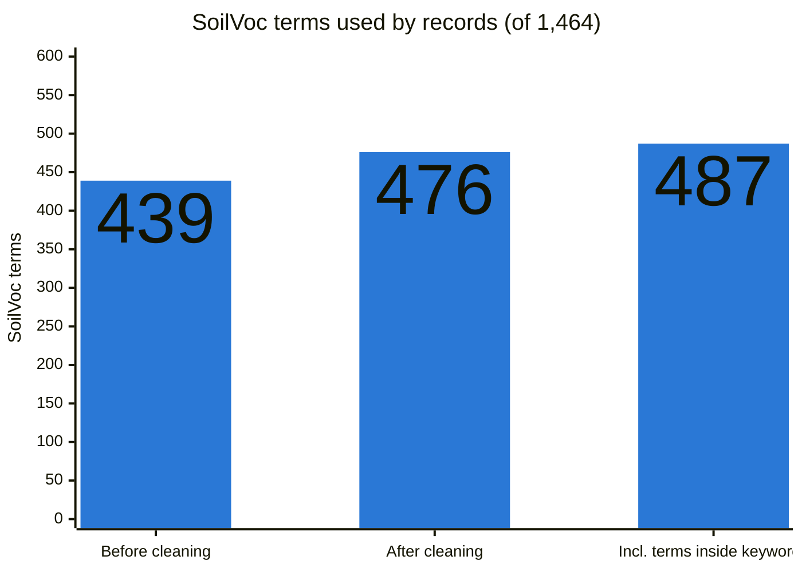
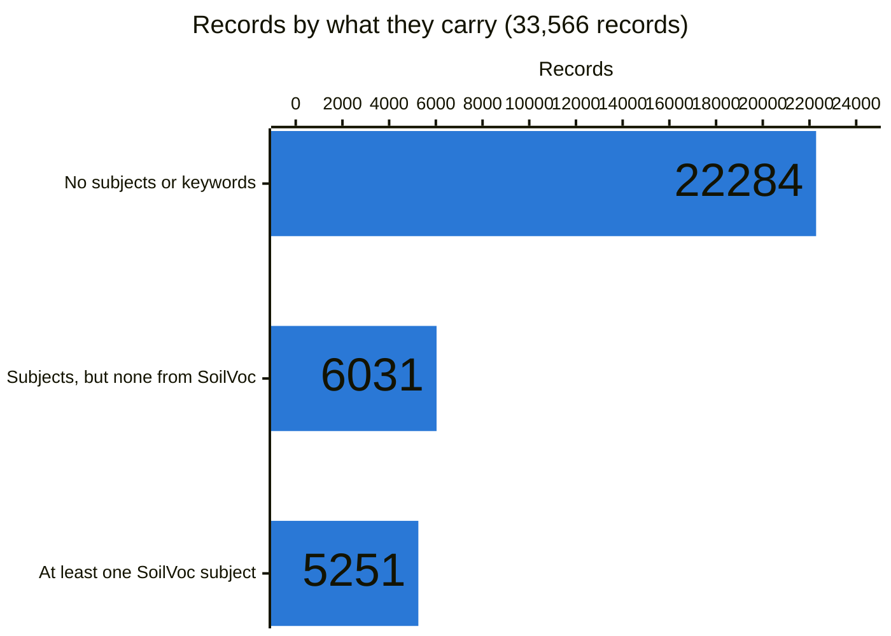
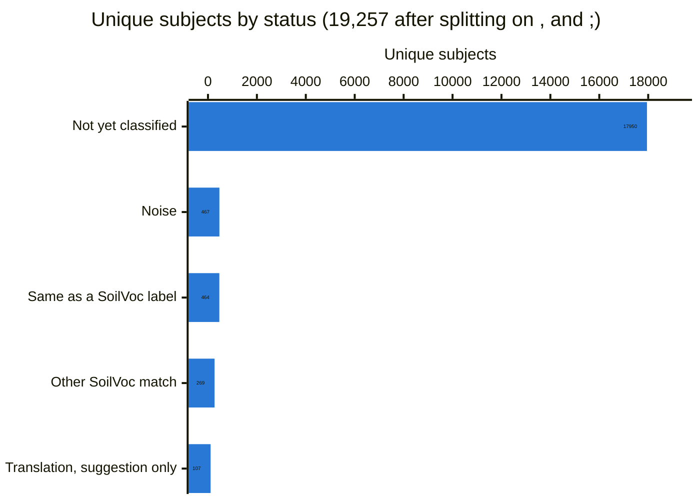
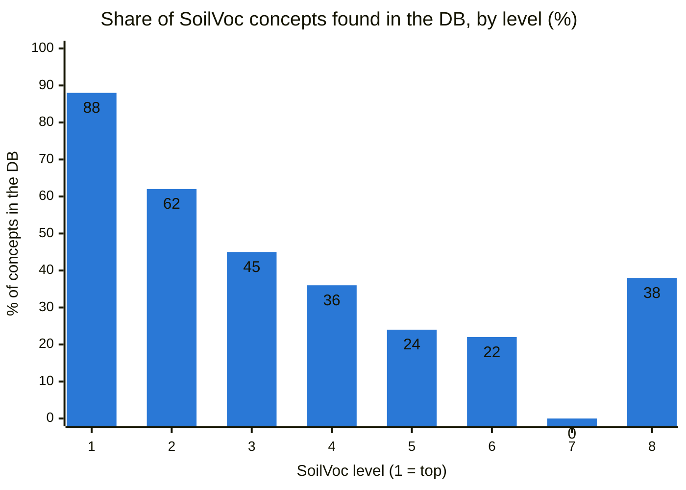
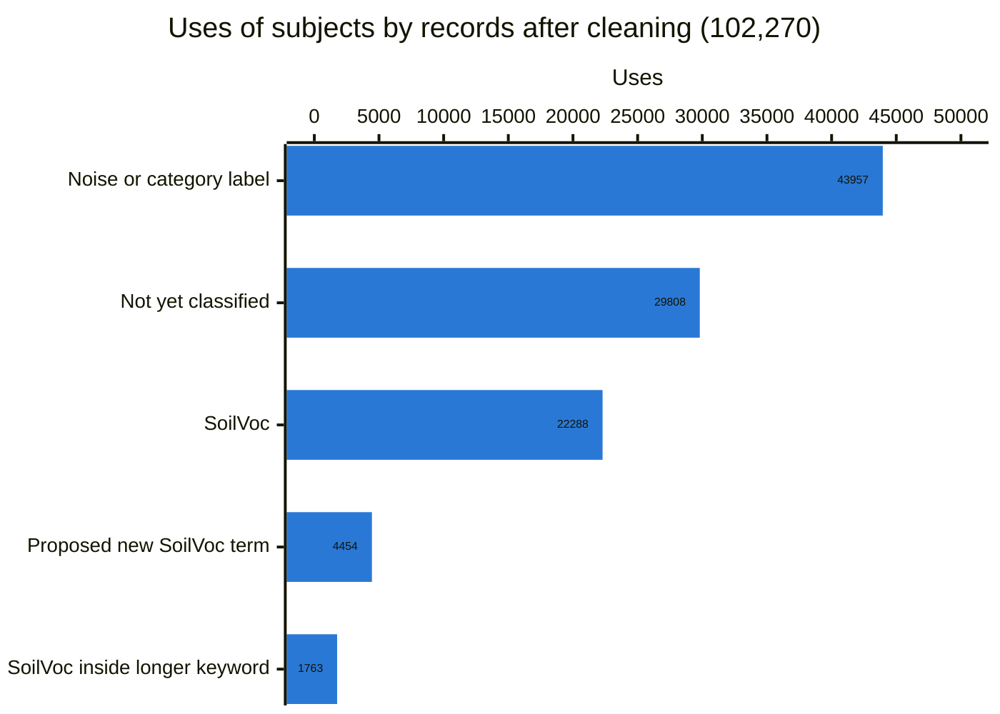
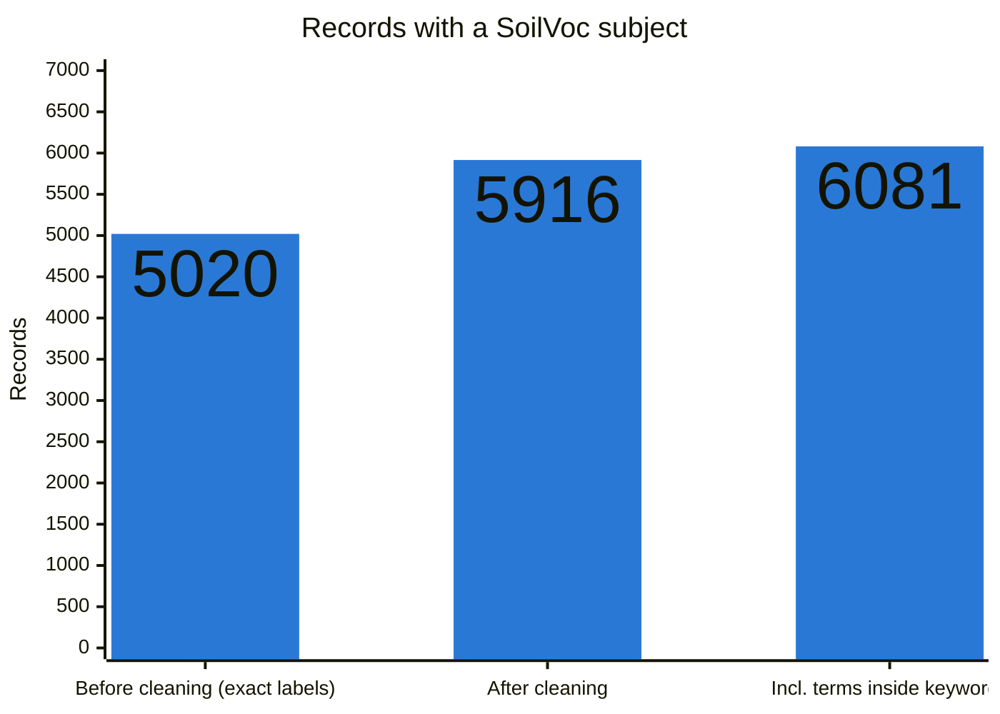
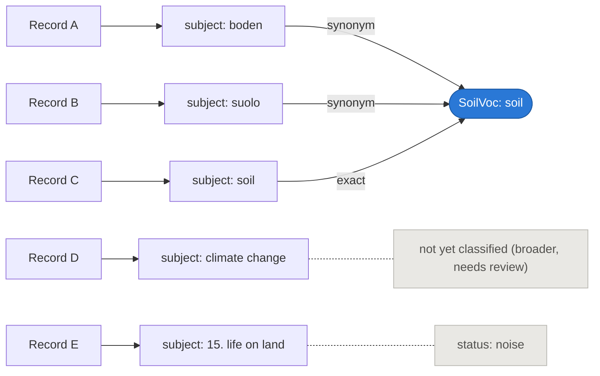
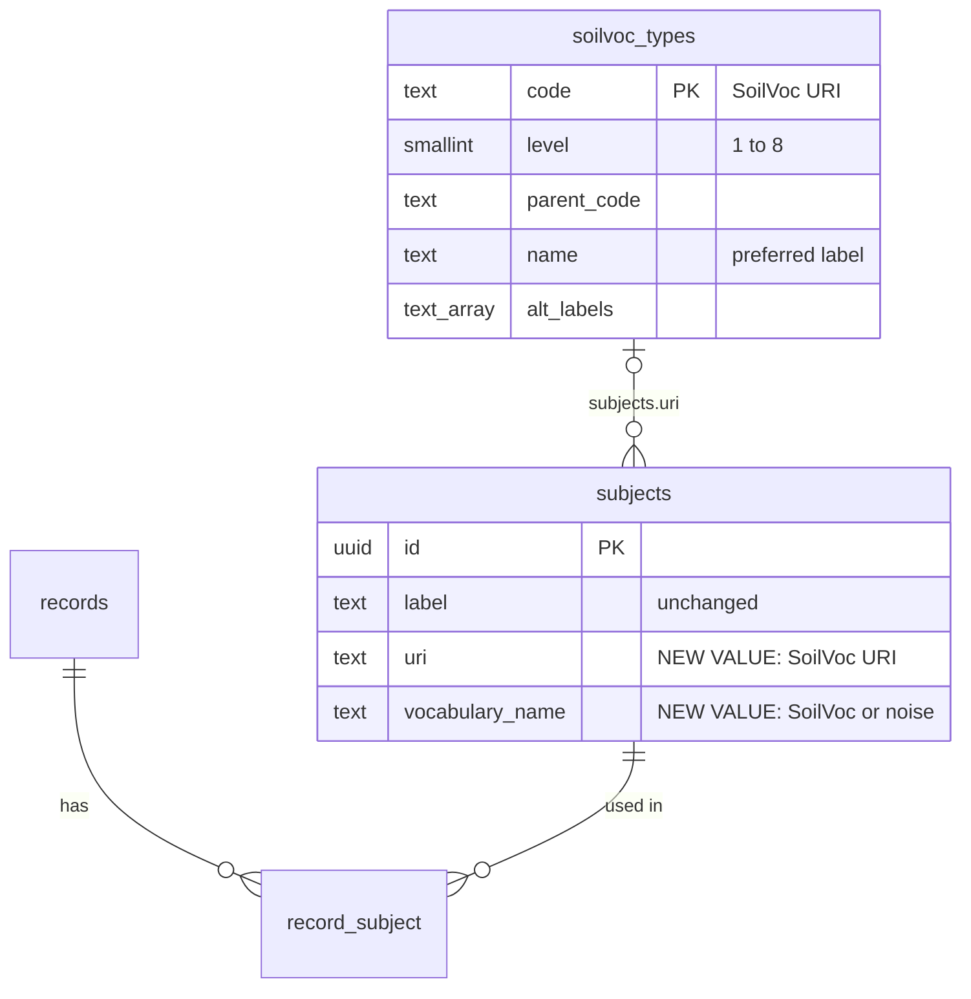
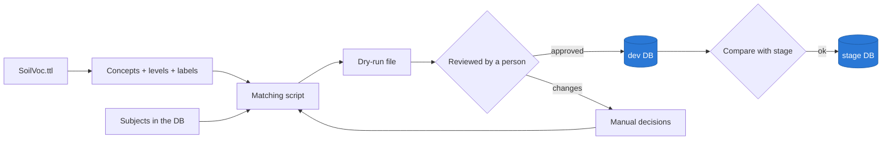
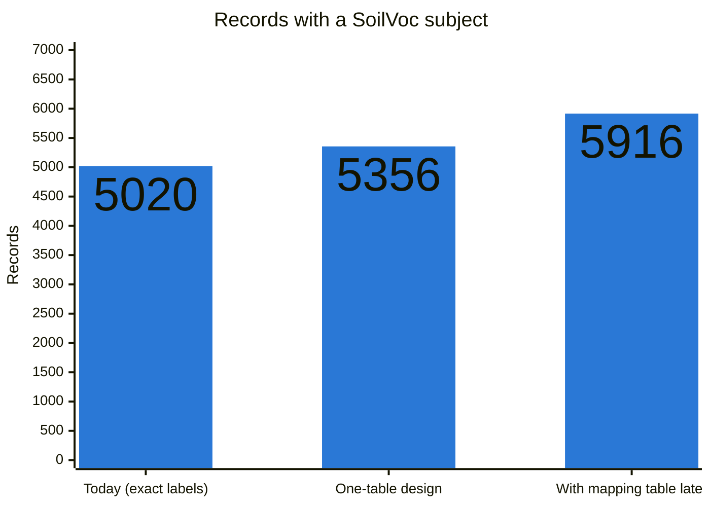

# Plan: populate SoilVoc in the DB for keyword/subject noise filtering

Task from the PO: *"Populate SoilVoc vocabulary in the DB for Keywords/Subjects noise filtering"*.

Numbers come from a read-only check of the stage DB (`msp-kh-stage`, schema `validate`) on 2 November 2026.
Details: `report.md`, `records_and_keywords.md`, `../subjects_cleaned/` and `../subjects_vs_soilvoc/`.

## Summary: SoilVoc keywords in use after cleaning

- **476 of 1,464 SoilVoc terms (33%)** are used by at least one record's subjects. Before cleaning: 439.
- **487** if SoilVoc terms found inside longer keywords are also counted (e.g. "sustainable soil management" → soil management).
- **1,063 unique DB keywords** map to those terms. Before cleaning: 464.
- **5,916 records** have a SoilVoc subject: 17.6% of all records and 60% of the 9,836 records with subjects. Before cleaning: 5,020.

## Where we are now

- 33,566 records in total. Only 11,282 (34%) have subjects or keywords; about 22,300 have none.
- 5,251 records (16%) have a subject or keyword that is exactly a SoilVoc label.
- Only 464 of about 19,300 unique subjects (2.4%) are written exactly as a SoilVoc term. Many others mean the same thing in another form: translations (boden, suolo → soil), plurals and spellings (soil type → soil types), or related terms.
- 467 subjects are clear noise: SDG labels, portal tags, codes and numbers.
- SoilVoc is not stored in the DB as a vocabulary. The `subjects.uri` and `vocabulary_name` columns are empty for all rows.
- The DB already holds a partial SoilVoc matching in `raw_metadata.matched_subjects` (4,595 records). We need to confirm where it comes from so we don't build a second, conflicting one.

SoilVoc's broad terms are used much more than its detailed ones:

## Keyword cleaning (done in CSV, not in the DB)

All subjects were read from the stage DB (read-only), cleaned, and saved as CSV files. Nothing was changed in the DB.
Script: `scripts/clean_subjects.py`. Output: `../subjects_cleaned/`.

What the cleaning does, in order:

- **Tidy:** lower case, extra spaces, quotes, `#` and trailing punctuation removed.
- **Wrappers and code prefixes removed:** `name=soil science` → soil science, `mesh: biomass` → biomass, `anzsrc::4106 soil sciences` → soil sciences, `ciencias de la tierra::2511 ciencias del suelo` → ciencias del suelo (158 parts).
- **Split:** combined labels split on `,` `;` `|` `·` and `/` (2,996 parts). Short lists with "and" stay one phrase ("agriculture, forestry, and fisheries"). Qualifiers after a slash are dropped (`soil/classification` → soil).
- **Number prefixes removed:** `15. life on land` → life on land, `sdg 13 - climate action` → climate action, `106022 microbiology` → microbiology (105 parts).
- **Brackets removed:** `geology [science]` → geology, `biology (general)` → biology (584 parts).
- **Joined words:** `soil-type` and `nature‐based solutions` (typographic dash) → spaces, `SoilHealth` → soil health, `ejpsoil` → soil (about 2,700 parts).
- **Language changed to English** (3,221 parts):
  - manual decisions (boden → soil, suolo → soil): 255
  - multilingual SoilVoc labels (bodenfruchtbarkeit → soil productivity, zink → zinc): 127
  - a new translation list, `curation/keyword_translations.csv`, with 2,598 keywords in about 30 languages (German, Italian, French, Spanish, Dutch, Portuguese, Finnish, Catalan, Russian, Greek, Chinese, …): 2,839 parts. Examples: usage du sol → land use, bodenausgangsgesteine → parent material, lõimis → soil texture, донные отложения → bottom sediments. 2,344 were translated by Claude and the last 254 by Claude Haiku subagents; all still need a check by a person.
  - The Haiku pass also marked 352 keywords as place names, organisations or codes (`curation/keyword_kinds.csv`). These, plus about 270 that could not be translated with confidence, are left as they are (626 in total).
- **Spelling and plurals:** UK/US spellings and singular/plural forms are tried when matching (fertiliser use → fertilizer use), but the keyword itself is not respelled.
- **Category labels marked** (`curation/category_labels.csv`, 190 labels): SDG goals (life on land), OECD fields of science (natural sciences), HAL archive domains (life sciences), INSPIRE themes (area management, regulation zones and reporting units) and portal/metadata tags (high value dataset, raw data, wms).
- **Noise marked:** codes, IDs, grant numbers (`nerc ne/l00237/1`), library codes (`ddc:631`, `info:eu-repo/…`), project admin labels (`task 2 3`), numbers, dates, links and stop-list words.
- **SoilVoc terms inside longer keywords** (weaker link, kept apart): `sustainable soil management` → soil management, `land use change` → land use, `actual evapotranspiration` → evapotranspiration. Everyday single words (soil, water, root, salt…) are not used for this.

Result after cleaning:

- Unique keywords: 19,262 before, 18,334 after.
- **SoilVoc keywords: 1,063** (exact 688, synonym 82, translated by SoilVoc labels 98, mapped through AGROVOC/GEMET/USDA 116, plural/spelling 32, accents 2, broader 45), plus 29 that could mean more than one SoilVoc term and 830 that contain a SoilVoc term inside. "Exact" includes keywords that became an exact SoilVoc label after translation.
- **SoilVoc concepts used by records: 476 of 1,464** (439 before cleaning); 487 counting terms found inside longer keywords.
- **Records with a SoilVoc subject: 5,916** (17.6% of all records, 60.1% of the 9,836 records with subjects). Before cleaning: 5,020. Without broader links: 5,433. Counting terms inside longer keywords: 6,081.
- Noise: 1,046 keywords. Category labels: 377 (many translated INSPIRE theme names). Proposed new SoilVoc terms: 92.
- Not yet classified: 14,897 keywords: English topics that are not in SoilVoc (carbon, ecosystem, biodiversity, landslides…), species names, place and project names, and the 626 untranslated names and codes.

The `subjects` table (19,282 rows, 102,270 uses by records) after cleaning:

- **SoilVoc:** 1,421 rows (7.4%), used 22,288 times (22%).
- **SoilVoc term inside a longer keyword:** 883 rows (4.6%), used 1,763 times (2%).
- **Noise or category label:** 1,534 rows (8.0%), used 43,957 times (43%). Few rows, but they are on many records: this is what noise filtering removes.
- **Proposed new SoilVoc term:** 192 rows (1.0%), used 4,454 times (4%).
- **Not yet classified:** 15,252 rows (79.1%), used 29,808 times (29%). Mostly keywords used by only one or two records.

How much of this the one-table design can store: it allows one SoilVoc term per subject and no broader links. Under those limits the cleaning gives **443 concepts and 5,356 records**. The rest needs split combined labels, broader links or partial matches, so it would need the small mapping table later.

## What we are going to do

- **Load SoilVoc into the DB in one new table, `soilvoc_types`:** all 1,464 concepts with level (1–8), parent and labels. It has the same shape as the existing `landcover_types` and `landuse_types`, with the alternative labels in one array column.
- **No mapping table:** reuse the two existing `subjects` columns, which are empty today.
  - `subjects.uri` gets the SoilVoc URI (boden → `https://w3id.org/eusoilvoc#Soil`).
  - `subjects.vocabulary_name` gets `SoilVoc` for matches, `noise` for noise, and stays empty for "not yet classified".
- **Show synonyms under one SoilVoc term:** boden, suolo and soil all point to the concept *soil*, so filtering on *soil* finds all of them. The subject label itself is not changed.
- **Link only safe matches:** exact matches and true synonyms only, one concept per subject.
- **Leave unclear cases as "not yet classified" for now:** the 46 broader mappings (climate change → climate), 15 subjects that could mean more than one concept (FAO vs WRB Andosols), and 713 combined labels such as "agriculture, climate change" (3.7% of subjects).

How subjects are linked: `subjects.uri` points to the SoilVoc concept, and the label stays as it is.

One new table. Everything else uses columns that already exist:

The cost of keeping it to one table: each subject links to one concept only, and there is nowhere to store "broader". If those are needed later, a small mapping table can be added without changing anything above.

## How we will do it

- **Reuse the existing matching:** it is already built and tested (`scripts/compare_subjects_to_soilvoc.py`). It covers exact matches, mappings via AGROVOC/GEMET/USDA, spelling variants, cleaning rules, and 698 manual decisions.
- **Dry-run first:** a file lists every link that would be inserted (subject, original label, SoilVoc term, relation), for review.
- **Check by hand:** a person spot-checks the manual decisions, especially synonyms and broader links, before anything is loaded.
- **Dev first:** we load into the dev DB, compare with stage, then promote to stage.
- **Keep it running:** later, the same matching runs at harvest time so new records are linked automatically.

## What we will achieve

- **Subjects linked:** 1,133 subjects (whole, not split) linked to one SoilVoc term each, reaching 443 SoilVoc concepts. Before cleaning, 464 unique subjects matched exactly.
- **Records reached:** 5,356 records get at least one SoilVoc subject with the one-table design, up from 5,020 with exact matches only. With split combined labels and broader links (a mapping table later) this goes to 5,916, and to 6,081 with terms found inside longer keywords.
- **Noise flagged:** 1,046 noise keywords and 375 category labels (SDG goals, fields of science, INSPIRE themes, portal tags). They are only 8.0% of subject rows but 43% of all subject uses, so hiding them cleans filters and search a lot.
- **Clean filters:** based on SoilVoc levels 1–2 (e.g. soil threats › soil erosion), which are well covered: 88% and 62% of those concepts appear in the data.
- **Nothing lost:** original keywords stay in the DB, every change is reversible, and real topics that aren't in SoilVoc yet are kept as "not yet classified", not thrown away as noise.

## Next steps after this task (need agreement)

- **New terms:** add 79 proposed SoilVoc terms for common topics missing today: agriculture (658 records), biodiversity (331), soil protection (144) and others.
- **Synonyms:** add 130 synonyms and reviewed translations to SoilVoc as alternative labels.
- **Records without subjects:** suggest SoilVoc subjects for the about 22,300 records with none, from title and abstract using an LLM. A tool is ready; the estimated cost is about $3 via the Mistral API, starting with a checked sample of 200 records.

## Questions for the PO

- Should we load into dev, stage or both?
- Should noise subjects be hidden in the UI only, or also marked in the data?
- Is it fine to store `noise` in `subjects.vocabulary_name`, or would you rather have a small `is_noise` column?
- Who set up `raw_metadata.matched_subjects`, so we can align with it?
